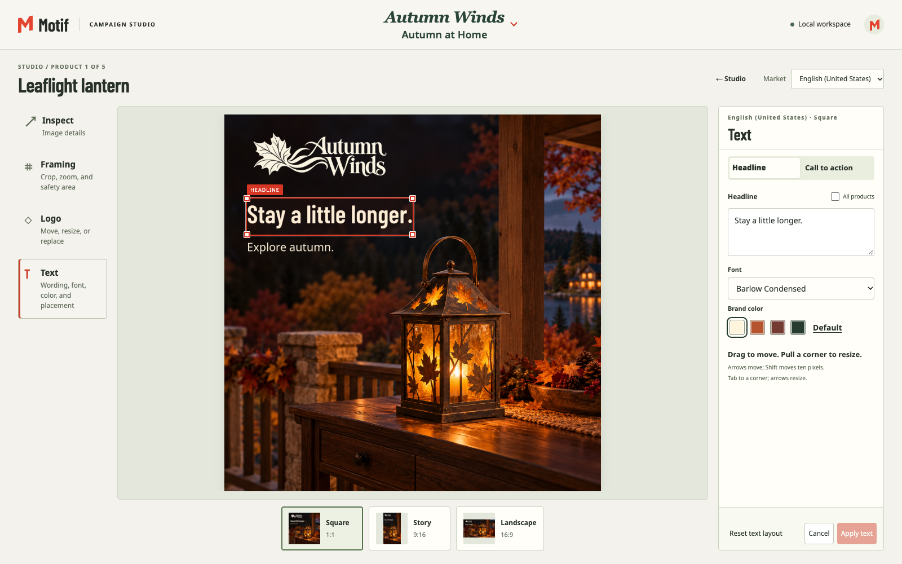
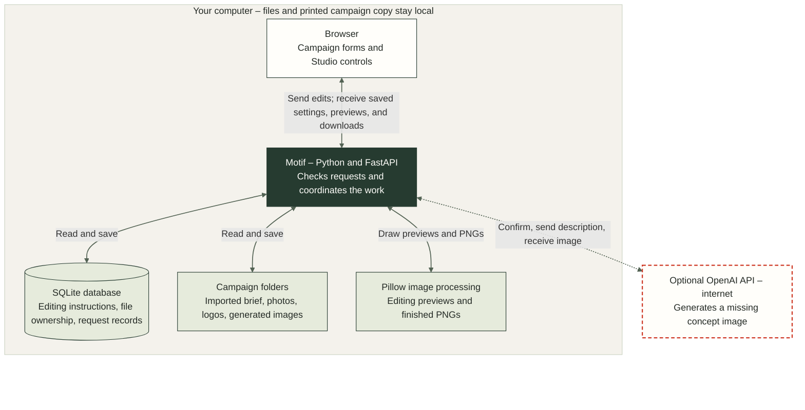

# Motif – Campaign Studio

**Version 0.3.1** · Native Windows, macOS, and Linux support · [Release notes](docs/release-notes.md)

Motif is a local creative-production application built as a simulated forward-deployed AI engineering exercise. It supports the producer workflow in the supplied customer scenario: reuse available imagery, deliberately generate a missing source, compose exact supplied wording and branding, and hand off campaign PNGs across products, formats, and markets. Planning, production, correction, and delivery stay connected.

The central decision is to **generate source imagery only when needed, then compose exact supplied copy and branding locally**. One product source can support two markets and three formats. A wording, crop, logo, or text-style correction reuses that source instead of buying another image generation.



## Evaluation materials

[The submission website](https://motif.brucebracken.com/) provides a visual overview of the workflow, architecture, and decisions. This README provides setup instructions and the detailed behavior reference.

The application includes two seasonal campaigns: Autumn Winds provides a completed key-free example; Bridle & Bough provides a deliberate missing-image generation journey. The [example and import guide](examples/README.md) distinguishes these campaigns from engineering fixtures.

Use the supplied ZIP to install this version locally. The [public release download](https://github.com/brucebrackenjr/campaign-studio/releases/latest/download/motif-campaign-studio.zip) provides the published version. You can also [watch the walkthrough](https://motif.brucebracken.com/#walkthrough), [browse the source](https://github.com/brucebrackenjr/campaign-studio), or [read the verification notes](docs/verification.md).

## Contents

- [What the application demonstrates](#what-the-application-demonstrates)
- [Run locally](#run-locally)
- [Try a complete workflow without a key](#try-a-complete-workflow-without-a-key)
- [Create new imagery with your own key](#create-new-imagery-with-your-own-key)
- [The producer workflow](#the-producer-workflow)
- [Brief, copy, and asset contract](#brief-copy-and-asset-contract)
- [Exported files and examples](#exported-files-and-examples)
- [Architecture and data flow](#architecture-and-data-flow)
- [Stack and decisions](#stack-and-decisions)
- [Where prompts and pixels come from](#where-prompts-and-pixels-come-from)
- [Persistence, identity, and cleanup](#persistence-identity-and-cleanup)
- [Paid requests, Stop, and recovery](#paid-requests-stop-and-recovery)
- [Metrics and their meaning](#metrics-and-their-meaning)
- [Verification and development](#verification-and-development)
- [Troubleshooting](#troubleshooting)
- [Scope and limitations](#scope-and-limitations)
- [AI assistance and attribution](#ai-assistance-and-attribution)

## What the application demonstrates

Motif covers a campaign’s input, production, correction, and delivery stages. It is a local single-user prototype, with a browser interface and ordinary files that can be inspected outside the application.

The assessment separates minimum pipeline requirements from three optional bonus categories. Motif implements those categories with the following boundaries:

| Assessment area | Motif implementation | Scope |
| --- | --- | --- |
| Campaign brief | Campaign forms capture products, audience, and campaign message; JSON briefs define one or both supported markets. One to five products are supported; the included campaigns contain five and three distinct products. | Minimum: at least two products and the required brief information. |
| Asset reuse | Attach finished PNG or JPEG imagery and reuse it locally. A missing or damaged attachment never silently becomes a paid request. | Minimum: accept and reuse available assets. |
| Missing imagery | Explicitly choose generation for an absent source, review the plan, and confirm an image-model request. | Minimum: generate missing imagery. This path creates an invented concept, not a fidelity promise for an existing photographed product. |
| Three aspect ratios | Square **1080 × 1080 (1:1)**, Story **1080 × 1920 (9:16)**, and Landscape **1920 × 1080 (16:9)** PNGs. | Minimum: at least three formats. |
| Printed campaign message | Compose exact supplied English copy locally; Spanish (Mexico) copy can be supplied separately. | English is the minimum; supplied localization is an additional capability, without translation or language detection. |
| Local execution | A Python application serves the browser interface and CLI checks on the evaluator’s machine. | Minimum: a local CLI or app. No hosted service is required. |
| Organized delivery | Download a ZIP organized by product and format, with language-specific PNGs, an offline HTML overview, and a manifest. | Minimum: clearly organized output files. |
| Documentation | Setup, inputs/outputs, decisions, assumptions, and limitations are explained here and in the linked references. | Minimum README and the requested comprehensive submission documentation. |
| Brand checks | Check supplied logo presence and approved text colors, with layout and rendering validation. | Optional bonus. |
| Legal content checks | Match configured prohibited phrases in printed headlines and CTAs and require correction or a deliberate rule change before export. | Optional bonus. |
| Logging and reporting | Record which image requests were sent, whether they succeeded, and their estimated cost. The exported report lists the delivered images, identifies supplied or AI-generated photographs, and includes any descriptions the producer supplied. | Optional bonus. |

Additional controls serve concrete production needs:

- **Direct composition editing** lets the producer move and resize the logo, headline, and CTA, adjust framing, and choose from two packaged fonts and brand-palette colors. Different image compositions need different placements to keep the product and wording readable.
- **Autosave and live previews** keep Campaign and Studio connected. Editing saves the current instructions; downloading creates the finished PNGs from those instructions and the retained sources.
- **Request planning and source reuse** make the proposed generation work visible and keep copy or layout corrections separate from another paid image request.

These workflow assumptions come from the supplied scenario and hands-on prototype use, not external customer research. The prototype concentrates on producing and correcting assets.

The complete output count is:

**products × selected markets × 3 formats**

Two products and two markets produce 12 PNGs. Five products and two markets produce 30. Three products with English (United States) only produce nine. These are output counts, not paid-request counts: a campaign made entirely from supplied or verified saved sources needs no new image-generation request.

The trash button on each Workbench card shows the files Motif will remove and asks you to confirm the campaign.

## Run locally

### Requirements

- **Python 3.14.4**, as pinned in [`.python-version`](.python-version). The package supports the Python 3.14 series.
- **macOS, Linux, or Windows** with a writable folder on a local drive. On Windows, use a regular local folder under your account, such as `C:\Users\you\Motif`. If Documents is redirected into OneDrive or uses reparse points, extract to another local folder. On a Mac that syncs Documents with iCloud, extract Motif to a local folder outside iCloud Drive when using uv.
- A current desktop browser. Connected verification includes Chromium journeys at 1440 × 900 and 1366 × 768; this is not a mobile or universal browser certification.
- An OpenAI API key only if you choose to generate new imagery. It is unnecessary for local composition, corrections, exports, or the key-free checks below.

Extract the supplied ZIP. The [public release download](https://github.com/brucebrackenjr/campaign-studio/releases/latest/download/motif-campaign-studio.zip) provides the published version. In Terminal or PowerShell, start in the directory containing the extracted Motif folder, then run:

```sh
cd Motif
```

This folder contains `pyproject.toml`, `uv.lock`, and this README. If you cloned the repository or used GitHub’s Code → Download ZIP, open the folder containing those files. Run either installation sequence below from that folder.

### Option A – locked uv environment

The documented installation was tested with **uv 0.13.6**, also pinned in CI. Install [uv](https://docs.astral.sh/uv/getting-started/installation/) if needed, then run:

```sh
uv sync --locked
uv run --locked campaign-studio serve
```

Open **<http://127.0.0.1:8000>**. Stop the server with **Control-C**. Keep one running application instance per data workspace.

For a simple server liveness check, open <http://127.0.0.1:8000/health>. It returns a small status response; it does not test provider credentials or establish that every campaign is valid.

### Option B – conventional Python environment

**macOS and Linux**

```sh
python3.14 -m venv .venv
.venv/bin/python -m pip install --require-hashes -r requirements.txt
.venv/bin/python -m pip install --no-deps --no-build-isolation .
.venv/bin/python -m pip check
.venv/bin/campaign-studio serve
```

**Windows PowerShell**

Run these commands from the same extracted Motif folder:

```powershell
py -3.14 -m venv .venv
.\.venv\Scripts\python.exe -m pip install --require-hashes -r requirements.txt
.\.venv\Scripts\python.exe -m pip install --no-deps --no-build-isolation .
.\.venv\Scripts\python.exe -m pip check
.\.venv\Scripts\campaign-studio.exe serve
```

From another directory, run `uv run --project 'C:\path\to\Motif' --locked campaign-studio serve` or `& 'C:\path\to\Motif\.venv\Scripts\campaign-studio.exe' serve`. No activation script is required.

[`requirements.txt`](requirements.txt) is exported from the same lock used by `uv`. It includes the pinned build dependency for the local package installation. There is no JavaScript package installation or frontend compilation step. Node is needed only for the developer JavaScript tests, which were run locally with **Node 26.7.0**.

### Choose a workspace or port

Motif keeps its code, installed environment, and default data together:

```text
Motif/
  .venv/
  src/
  Walkthrough Assets/
    Winter at the Ranch.json
    Bentwood toboggan.png
    Long Ride sleigh blanket.png
    Bridle and Bough logo.png
  Workspace/
    Campaigns/
      Autumn Winds-901f13e2/
        Brief/
        Assets/
        Runs/

    private/
      state.sqlite3
```

Campaign subfolders appear only when their files are needed. The `private` folder holds the shared database and application control files. SQLite stores one current editable campaign, including its text, logo, crop, and style settings, alongside source references and request records. Motif does not maintain finished PNGs or write working `draft.json`, `plan.json`, or `manifest.json` copies in the campaign folder. An imported original brief remains in `Brief/Imports/`. Finished images and their delivery manifest are created for the download.

Both installation methods find this workspace from the installed environment. On macOS and Linux, to start from another directory, use `uv run --project "/path/to/Motif" --locked campaign-studio serve` or invoke `"/path/to/Motif/.venv/bin/campaign-studio" serve`. If you move Motif, recreate its .venv at the new location using either install sequence. Back up the whole Workspace folder together while the server is stopped. On macOS and Linux, keep the installation’s private .env separately if you want to retain its settings. Deleting the extracted Motif folder removes its local installation and default workspace. Explicit external workspaces and exports you saved elsewhere remain at their chosen locations.

To keep an evaluation separate from other work:

```sh
uv run --locked campaign-studio serve --data-dir ./motif-evaluation-data
```

To use a different port on any platform, set `CAMPAIGN_STUDIO_PORT=8001` in `Motif/.env` before starting the server.

The `--data-dir` argument takes precedence over `CAMPAIGN_STUDIO_DATA_DIR`; environment settings take precedence over values in `Motif/.env`. The data directory path must not pass through a symbolic link or Windows junction. The Python package, executable, and configuration prefix remain `campaign_studio`, `campaign-studio`, and `CAMPAIGN_STUDIO_*`.

When this build opens a supported v0.2.0 workspace, it transfers the current editing settings and source references into the current campaign document, then removes verified obsolete working PNGs and edit records. Original imports, source imagery, existing exported packages, and files you added yourself are preserved. Back up the complete Workspace with Motif stopped before upgrading. Earlier 0.1.x layouts require their original application. Use `--data-dir ./motif-projects` with the server command to select a separate workspace.

If Motif reports a missing or incomplete workspace database, stop the app and restore the complete Workspace folder from backup. Its private/state.sqlite3 and Campaigns folder belong together.

## Try a complete workflow without a key

On its first launch into an absent or empty data directory, the official server command installs two ordinary campaigns before Home is ready. It imports their sources, wording, and layouts without creating finished campaign PNGs or making an API request.

| Included campaign | Initial state | Useful evaluation path |
| --- | --- | --- |
| **Autumn at Home** · Autumn Winds | Five products, two markets, and sources ready for **30 variations**. Zero application requests. | Choose **Continue working**, edit in Studio, and download the finished campaign from Handoff. |
| **Winter at the Ranch** · Bridle & Bough | Three products and two markets; **18 planned variations**. The Brass sleigh-bell strap source is missing. Zero application requests. | Inspect the supplied sources and the missing-image plan. Generating that source requires your key and explicit confirmation in Production. |

The supplied seasonal imagery was prepared externally with built-in image generation. Its provenance does not represent a new request made by this installation.

Setup is once per fresh workspace, not whenever the campaign count reaches zero. Existing workspaces are not automatically populated, and deleting a bundled campaign does not bring it back. If setup is interrupted, the next launch resumes unfinished examples. Motif preserves examples you edited or deleted.

To work from your own inputs, use **Create campaign** or **Import brief** from Home. Supply product photographs and the copy for each market. Add a logo if the campaign uses one. A plan with no new sources can compose and export locally.

For an import walkthrough, open **Walkthrough Assets** directly inside the extracted **Motif** folder. Choose **Import brief** and select **Winter at the Ranch.json**. In Campaign, attach **Bentwood toboggan.png** and **Long Ride sleigh blanket.png** to their matching products, then attach **Bridle and Bough logo.png** in Brand. The third product, **Brass sleigh-bell strap**, intentionally has no supplied image; Production explains the request and cost before you confirm generation with your own API key. The brief includes English and Spanish copy for all three formats. These four input files remain separate from the campaigns you create, so you can use them again for another walkthrough.

For a repeatable installation check, use a separate data directory:

```sh
uv run --locked campaign-studio smoke --data-dir ./motif-check-data
uv run --locked campaign-studio sample-run --data-dir ./motif-check-data
uv run --locked campaign-studio sample-run --products 3 --us-only --data-dir ./motif-check-data
uv run --locked campaign-studio sample-run --replay --data-dir ./motif-check-data
```

These commands write test campaigns or check artifacts into the selected directory. They do not call the provider.

| Command | What it establishes |
| --- | --- |
| `smoke` | Basic installed-resource, image, JSON, and SQLite operation using a labeled 128 × 128 geometric image. |
| `sample-run` | A synthetic two-product, two-market campaign, 12 outputs, a six-output local correction, and portable export. |
| `sample-run --products 3 --us-only` | The output matrix works for three products and one market, producing nine outputs. |
| `sample-run --replay` | Genuine saved imagery can be reused and corrected locally, with 12 outputs and zero new provider attempts. Historical generation remains separately identified. |

The geometric examples and saved-source replay are verification fixtures. They are separate from the two included seasonal campaigns and do not establish creative approval. See [the examples guide](examples/README.md). There is no special Open example shortcut in the application; ordinary saved campaigns appear in the Workbench.

## Create new imagery with your own key

For a product without an image, select **Generate new image** and describe the subject. Production shows the source requests, output count, request allowance, and estimate before confirmation. The current provider request sends the concept description, audience, and creative direction as text; this path does not upload supplied photographs or the logo.

If a key is missing, use **Add your OpenAI API key**. On macOS and Linux, the masked dialog saves the key in the installation’s private `.env`. On Windows it encrypts the key for the current Windows user and writes the ciphertext to `Workspace/private/openai-key.dpapi`. A successful save activates the key. If you move a Windows workspace to another account or computer, its campaigns remain editable. Enter a new key in Production when you need generation. **Saving a key does not test provider access, confirm a plan, or start generation.** After a rejected key is replaced, Production shows **Resume generation**. Review the request count and estimate, then confirm to try again. A newly saved key has not yet been verified by the provider. To remove a locally stored key, open **OpenAI key** in Production and choose **Remove API key**. This removes Motif’s stored credential; it does not revoke the key in your OpenAI account. An environment-managed key must be changed outside Motif.

Alternatively, configure `OPENAI_API_KEY` in the process environment before starting. On macOS and Linux you can also configure the installation’s private `.env`. An explicitly supplied environment value wins, including an empty value. In that case, update the launch environment and restart; the dialog explains that the environment manages the key. Manual edits to `.env` also require a restart. The launcher reads that one file, without parent-directory discovery.

If you prefer to remove the key manually, stop Motif first. On macOS or Linux, remove the `OPENAI_API_KEY` entry from `Motif/.env`; on Windows, delete `Workspace/private/openai-key.dpapi`. Remove any separately configured `OPENAI_API_KEY` environment value as well, then restart. The **Remove API key** button described above handles this without restarting.

No API key ships with the application. Keep credentials out of briefs, screenshots, exports, and source control. [`.env.example`](.env.example) documents the configuration names an evaluator may need. Missing or rejected credentials do not prevent working with intact saved imagery; ordinary validation and export rules still apply.

## The producer workflow

The four campaign pages are **Campaign → Production → Studio → Handoff**. Home contains the Workbench and **Continue working**, which opens the most recently saved ordinary campaign. Opening a campaign does not manufacture new save activity.

### 1. Campaign – establish the campaign

Create or import a campaign, then set its name, audience, creative direction, supplied headline/CTA copy, and brand palette. The subtabs are **Brief → Products → Brand → Copy & Rules**. Attach the product photographs you have and a logo if the campaign uses one. Each market has its own supplied wording.

Editing a headline or call to action in **Copy & Rules** updates that field for every product in the selected language, including products whose wording you previously changed in Studio. It leaves the other text field, other languages, fonts, colors, and positions unchanged.

If that change would replace custom wording, Motif asks first. **Cancel change** restores the previous Campaign field and keeps the individual wording. Confirming the replacement updates every product in the language. When there is no custom wording to replace, the field saves automatically.

Campaign and Studio use the same current saved instructions. Campaign form fields autosave after a short typing pause, including unfinished values. Routine saves are silent. A save failure or conflicting browser tab remains visible with a recovery action. Saving does not make an AI request or create finished PNGs.

Changing Brand's default text color updates text that inherits that color. A color deliberately customized in Studio remains specific to that image. **Use default for this image** restores inheritance. There is no separate Update Images action: saved changes are available when opening Studio or Handoff.

### 2. Production – inspect and confirm the work

Add or edit up to five products from Campaign’s Products subtab or Production. Both open the same product editor. Choose an existing image or describe the missing source you want generated. Adding or removing a product is a deliberate action; edits to existing product fields use autosave. Saving a generation description does not send it to the provider.

Production identifies which sources can be reused and which require an AI request. Review the request count, prompt, data-transfer details, and estimate before confirming generation. Production saves the resulting source photographs so they can serve multiple formats and markets. It does not create the finished branded PNGs.

A confirmed request uses fixed inputs and settings. Relevant changes before dispatch require a fresh plan. A request already underway finishes its confirmed work while newer campaign edits remain saved. Sources are reused only when their identity, content, and generation inputs still match.

### 3. Studio – compose the campaign

Studio displays previews built from the current sources and saved editing instructions. Open a product to keep its image in one workspace: tools are on the left, the canvas is in the center, selected-tool controls are on the right, and the three formats are below the canvas. Inspect opens first. Choose a market and format, then select a tool:

| Control | Scope and behavior |
| --- | --- |
| Inspect | Save an accessible description and inspect factual source provenance. These are not approval markers or a review-status workflow. |
| Framing | Zoom in and drag the photo to reframe it, or use the horizontal and vertical position sliders. Optional important-area bounds constrain crops; the guide is not drawn into exported pixels. |
| Logo | Move or proportionally resize the logo for the selected output. Replacement is a separate campaign-wide action with an explicit affected scope. |
| Text | Select **Headline** or **Call to action** to edit its wording, font, palette color, position, and size together. Typing changes the selected product's wording across its three formats in the selected language. Click **Apply to all products** to use that wording for every product in the language and update the matching Campaign → Copy & Rules field. Font, color, position, and size remain specific to the selected product, language, and format. Choose Noto Sans Regular or Barlow Condensed Semibold; drag the text to move it, and pull a corner or use the keyboard to resize it. |

**Apply to all products** is a single action, not a setting that stays on. After clicking it, later typing in Studio again changes only the selected product. Applying a headline does not change the call to action, and applying a call to action does not change the headline. Other languages and individual layout choices remain unchanged.

If wording matches a campaign’s prohibited list, Motif identifies the affected product and field. If text extends outside an image, it asks the producer to move or resize that text. The second check depends on the font, size, wrapping, and position; it is separate from the input character limit. Studio keeps the preview visible for correction, and the warnings update after the change saves. The campaign must pass these checks before download.

Studio autosaves text, color, font, logo, crop, and description changes. A drag saves when the gesture ends; typing saves after a pause. The canvas gives immediate visual feedback while saving. There is no Apply button. Reopening the image restores the saved instructions and original source, so its text and logo remain editable.

Navigation waits for pending saves. If a save fails, the proposed edits remain available and the interface offers a retry. If the campaign was updated elsewhere, Motif pauses saving and offers **Refresh** to load the latest changes, warning that this window’s unsaved edits will be discarded. A lost response is checked before retrying the same request. Temporary previews share the compositor used for export; ordinary saves do not write finished images to the campaign folder.

### 4. Handoff – create and download the finished files

Handoff shows previews from the current saved instructions. **Download ZIP** captures one consistent set of settings and source images, creates the finished PNGs, prepares the ZIP, checks it, and starts the browser download. Progress messages identify the actual stage. Individual image downloads create only the requested finished PNG. There is no separate Generate Images or Export Folder action.

The ZIP contains images, an offline HTML overview, and a delivery manifest. A partial package can include valid available images and explicitly list missing outputs. Export never generates a missing source with AI; that remains a deliberate Production action.

**Configured prohibited wording is a campaign-wide export gate.** A match blocks ZIPs, individual PNGs, and the offline report preview. Correct the named text or deliberately edit the rule, allow autosave to finish, then retry. Invalid current settings must also be corrected before delivery. A saved draft is allowed to be incomplete while you work; incomplete or invalid data is not silently replaced by older image settings during export.

Downloads already saved outside Motif remain independent files. Later changes affect the next export, not an existing download.

## Brief, copy, and asset contract

The authoritative input contract is [the generated JSON Schema](docs/brief.schema.json), backed by the Pydantic models in [`brief.py`](src/campaign_studio/brief.py). [The brief reference](docs/brief-format.md) explains the complete format and source roles. Unknown fields are rejected. For demonstration photos, provenance describes how the imagery was made; the `synthetic` flag is reserved for labeled test fixtures, not a claim about whether a photograph was AI-created.

| Input | Important behavior |
| --- | --- |
| Campaign | Lowercase hyphenated UUID string, editable name, audience, creative direction, brand, included markets, and one to five products. Create/import allocate a new campaign identity. Names need not be unique. |
| Brand | An optional logo, a palette of one to eight colors, and a text color from that palette. Select **Require a logo on final images** for campaigns that must carry one. Otherwise, Handoff flags its absence and lets you export. Completed six-digit hex values are normalized; unfinished form text is preserved as authored work. |
| Market copy | Required `message` and optional `cta`, supplied independently for `en-US` and `es-MX`. No translation, language detection, or language certification. |
| Product copy | Optional field-level `copy_overrides`. An omitted field inherits; `cta: null` deliberately clears the optional CTA. A required message cannot be cleared. |
| Phrase rules | Optional configured phrases with literal or whole-word matching and optional case sensitivity. All matches block; there is no advisory severity. |
| Source | `finished_scene` for an attached image, or `concept` with `imagery_absent: true` and a generation description. JSON import also accepts `prepared_product` for a transparent cutout composited over a generated background; the product editor does not offer that route. See the [source constraints](docs/brief-format.md#sources-and-framing). |

For example, this **market-content fragment** configures an ordinary whole-word prohibition; it is not a complete brief:

```json
{
  "copy": {"message": "Made for the next outing", "cta": "Explore the collection"},
  "phrase_rules": [
    {"id": "absolute-claim", "phrase": "guaranteed", "match": "whole_word", "case_sensitive": false}
  ]
}
```

Matching uses Unicode normalization and the configured literal/word-boundary semantics. It scans the current resolved headlines and CTAs, not generation instructions or arbitrary descriptions. It is a simple configured-text check, not a legal-compliance engine.

Structurally valid prohibited content can still be imported, opened, edited, and saved. Validation occurs when the producer requests a preview, prepares sources, or exports. A prohibited phrase does not make the campaign impossible to open for correction.

### Asset handling

- Upload **PNG or JPEG**, up to **20 MiB per file** and **40 megapixels**. A finished product scene must have a background and no transparent areas. Logos may be opaque or transparent; a fully transparent logo is refused. The separate prepared-product input described above intentionally accepts a transparent cutout.
- The server inspects the decoded content, applies orientation, and handles supported color profiles. Original source files are retained. A filename or MIME label alone is not proof that an image is usable.
- Imported asset paths do not grant filesystem access. Reattach the corresponding assets through the image and logo controls; imports do not read arbitrary paths from another machine.
- Replacement failure preserves the previous usable logo. Basic provenance remains factual; replacing an image does not establish ownership or inherit an unsupported rights claim.
- Per-output geometry is normalized against the actual source or output canvas. Text uses measured glyph bounds, not just an invisible selection rectangle. Intentional text/logo overlap is allowed; the producer remains responsible for readable composition.

## Exported files and examples

A package contains only the selected valid image files, its manifest, and the offline overview. Its layout is:

```text
Autumn Winds-a1b2c3d4/
├── index.html
├── manifest.json
└── images/
    └── Leaflight lantern/
        ├── English (United States)/
        │   ├── Square - 1080x1080.png
        │   ├── Story - 1080x1920.png
        │   └── Landscape - 1920x1080.png
        └── Spanish (Mexico)/
            └── ...
```

Download ZIP renders the current campaign into temporary storage and sends the completed package to the browser. Its temporary files and stream close after the response. No ZIP archive, output folder, or export-history record is retained in the workspace. Preview offline report uses temporary previews of the current saved composition; it creates no files in the campaign.

The ZIP and its extracted root use the brand name and a short snapshot suffix, such as `Autumn Winds-a1b2c3d4`. Product names stay readable; unsafe characters are replaced, long names are bounded, and duplicate names receive stable suffixes. Individual PNG downloads include the product, market, format, and dimensions.

Exports create the available images from one captured version of the current editing instructions. Missing outputs are recorded as omissions rather than represented by invented files. The manifest records the output matrix, dimensions, file hashes, actual supplied copy, source provenance, accessible descriptions, omissions, and relevant metrics. It does not include API credentials or raw provider responses.

Extract the ZIP, then open `index.html` in a browser. Keep the folder structure together when moving it. Images use relative references; the overview needs no running Motif server, API key, external font service, or network connection. The manifest is useful for programmatic inspection, while the HTML provides a readable handoff.

The overview labels these same formats Instagram post (Square, 1:1), Story (9:16), and Facebook post (Landscape, 16:9).

Each download contains the images and descriptions captured when that export started. The export verifies source hashes, checks the rendered PNGs, and validates the ZIP before delivery. An edit made during export cannot mix newer text or a newer logo into the package being prepared. A stale offline-preview link asks for a new preview rather than mixing saves. Current exports create no database history; packages registered by v0.2.0 retain their existing records for compatibility.

**Import another seasonal campaign.** The [Autumn brief and assets](src/campaign_studio/resources/campaigns/autumn-winds/) and [Bridle brief and assets](src/campaign_studio/resources/campaigns/bridle-and-bough/) are included in the Motif folder. Choose **Import brief**, select the campaign’s `brief.json`, and attach its named product images and optional logo through their controls. Import opens Campaign so you can fill in the remaining details at your own pace. Each import receives a fresh identity, even when its display name matches another campaign. Motif imports JSON; a ZIP exported from Handoff contains finished outputs and is not an import brief.

If a local image render fails during ZIP creation, Motif continues creating the other images and retries the failed image. The counter shows how many images have been created and checked. A persistent failure identifies the image and offers **Retry failed images**; successfully checked images remain in one temporary export job for that retry. Motif never silently omits a failed image or starts a paid AI request during export. Changing the campaign starts a new export from the current settings. Temporary export files are removed after delivery, cancellation, expiration, or application exit.

## Architecture and data flow

Motif runs on the producer’s computer. The producer works in a browser, and a Python application running on that same computer saves changes, checks inputs, and makes images. OpenAI is contacted only when the producer asks Motif to generate a missing product photograph and confirms the request.



The shaded boundary contains the local application. The dashed connection is the optional paid API request. Pillow creates temporary previews while editing and finished files on download; Motif checks and packages those files before returning them to the browser.

**Editing saves instructions, while the original pictures stay separate.** For example, moving a lantern’s logo in Studio saves its new position in SQLite. It does not permanently paint the logo into the photograph. Motif can reopen the photograph and logo in that saved arrangement, and you can move them again. Campaign details, such as the shared headline and default text color, are saved in the same campaign record. Shared color changes preserve deliberately customized colors. Shared wording changes replace the chosen headline or call to action across products without changing their styling.

**The database and folders have different jobs.** SQLite stores the campaign’s current details and editing instructions. The campaign folder stores the imported brief, uploaded photographs and logos, and photographs returned by OpenAI. SQLite also records which files belong to the campaign and what happened to each image-generation request. That lets Motif reopen the right files, delete the selected campaign safely, and recognize a request that was already sent. Ordinary edits replace the current settings rather than building a history of every adjustment.

**OpenAI creates a missing photograph; Pillow makes the finished ads.** A generated photograph can be reused for Square, Story, and Landscape images in both markets. Pillow, an image-processing library running locally in Python, crops the photograph and adds the supplied words and logo. Moving text or changing a color does not require another paid request.

**Download ZIP creates the finished files.** Motif first finishes saving pending edits. It then takes temporary copies of the settings and photographs needed for that download, so changes made in another window cannot alter some images halfway through. Pillow creates each PNG, Motif checks it, and the completed images go into a ZIP with an offline report and a list of the included files. If an image fails, Motif retries that image while keeping the successful ones temporarily. Those temporary files are removed when the download finishes, is canceled, or expires.

**The browser is an interface to a local application.** Motif listens at `127.0.0.1`, an address for this computer rather than a public website. Before saving, the server checks that the request came from Motif’s browser page, refers to that campaign’s files, and was based on the latest saved settings. An older tab cannot silently overwrite a newer save. The application has no separate user accounts. Supplied photographs, logos, and ad text stay local; a confirmed OpenAI request sends the product description, audience, and scene direction.

The canonical campaign pages are `/campaigns/<uuid>/campaign`, `/production`, `/studio`, and `/handoff`, all beneath the same campaign prefix. A malformed, unknown, or deleted identity receives the Motif **Campaign not found** page. A registered draft can open before its first run. Old page aliases are not supported. The v0.2.0 workspace layout is upgraded in place; older incompatible 0.1.x layouts require their original application.

## Stack and decisions

Alternative entries are explanatory architectural comparisons. Only the selected stack is implemented here.

| Choice | Reason | Alternative and trade-off |
| --- | --- | --- |
| Python 3.14 | Handles image processing, input checks, files, and OpenAI requests in one application. | A TypeScript server could use the same language as the browser, but would need different image-processing tools. Python suits the image work; browser interaction still uses JavaScript. |
| FastAPI, Uvicorn, and Pydantic | Uvicorn runs the local web server. FastAPI receives browser requests. Pydantic checks that submitted values have the expected structure and types. | A command-line-only tool would have fewer interface parts, but producers need to see and adjust their compositions. |
| Jinja2 and plain JavaScript | Jinja2 serves the page shell and startup settings. JavaScript fetches the saved campaign and handles controls, dragging, and preview updates. | Developers can run the interface without compiling and bundling a separate frontend. A larger editor would benefit more from React components and TypeScript checks; this interface requires explicit handling of requests that finish out of order. |
| Pillow and fontTools | Pillow crops photographs, draws the supplied text and logo, and creates PNGs. fontTools checks whether the packaged fonts can display the supplied characters. | A generated image cannot reliably preserve exact advertising wording through revisions. Local composition gives Motif control of that wording, while the producer judges its placement and readability. |
| SQLite plus image files | SQLite saves current settings and records which files and image requests belong to each campaign. Photographs and logos remain ordinary files. | A JSON-file-only application could work, but would need its own coordination for interrupted or simultaneous saves. A shared hosted application would call for a shared database and file storage. |
| One image-generation request at a time | Motif can track each request and stop the ones it has not sent yet. | Sending several requests at once could finish sooner, but would make stopping, request limits, and partial failures more complicated. |
| Official OpenAI SDK with a small integration module | The SDK sends requests to OpenAI. A separate module translates Motif’s request settings and handles the returned image and errors. | Adding another provider would require adapting its settings, errors, costs, and returned images, then testing that integration. |
| `uv.lock` and a matching requirements file | Both installation methods use the same recorded dependency versions. The requirements file also includes hashes to check downloaded packages. | The generated requirements file must be updated whenever the lock file changes. |
| Offline HTML report and PNGs | A recipient can inspect and use the delivered images without installing Motif or receiving an API key. | Online comments and approvals would need a hosted service with accounts and access controls. |

The [architecture explanation](docs/architecture.md) follows a logo move from the browser to SQLite and then into a downloaded PNG. It also explains conflicting browser saves, failed downloads, and the changes a shared hosted version would need.

## Where prompts and pixels come from

### Generation prompt and request

The saved generation request assembles a predictable prompt from the concept description, audience, and creative direction, adds photographic/composition instructions, and asks for no text or logo. Important subject content is requested inside the central region needed by the local crops. A prompt is guidance, not proof that the resulting image will respect every crop.

The configured snapshot is `gpt-image-2.5-flare-2026-09-08`, requesting one high-quality, opaque, **1920 × 1920 PNG**, with zero automatic retries and a **120-second overall deadline**. These settings are part of the plan digest. Access depends on the evaluator’s account; this README does not claim universal model availability or a newly verified current price.

The image-generation request is the provider network boundary. The delivered concept path sends text. Existing product photos, logos, exact advertising text, and local editor adjustments are handled locally. Motif has no prompt-writing agent or natural-language brief orchestrator.

### Copy, logo, and final composition

The local compositor handles image loading, crop geometry, text wrapping, glyph bounds, proportional logo placement, and final composition. It draws the supplied text after imagery exists. There is no implicit translation, shortening, rewriting, or disclaimer insertion.

The two packaged output families are **Noto Sans Regular** and **Barlow Condensed Semibold**. Each headline and CTA can select its own family and palette color. Default typography and color apply when no override exists. Font upload, system-font enumeration, arbitrary editor colors, rich text, and effects are outside scope.

Temporary previews and exported PNGs use the same compositor, fonts, and geometry rules. The browser also uses separate layers for immediate feedback while a handle moves. Autosave records the instructions; it does not retain a finished PNG. Downloading runs the final composition and integrity checks. Selection frames, guides, and handles do not enter the exported image.

## Persistence, identity, and cleanup

Motif keeps the current campaign settings. An autosave replaces those settings rather than adding a history entry for every logo move. Each save also changes a version marker inside the database. When another browser window tries to save using an older marker, Motif refuses that save and asks the producer to refresh. The campaign ID and folder name stay the same.

Campaign identity is a canonical hyphenated UUID, separate from its editable display name. SQLite records that identity and its permanent folder. Duplicate names are allowed. Renaming a campaign leaves its identity, folder, and URL unchanged.

| Inside a campaign folder | Contents |
| --- | --- |
| `Brief/Imports/` | An original imported JSON brief, when one was supplied. |
| `Assets/Products/` and `Assets/Brand/` | Supplied photographs and logos, named with the product or brand label plus a unique identifier. |
| `Runs/<id>/` | Inputs and response/source files associated with explicit source production. Autosave does not create these folders. |

New attachments keep a readable label, such as `leaflight-lantern-<identifier>.png`, while the identifier distinguishes separate files with the same label. Editing text, color, or framing does not rename the source file. Earlier registered asset names remain usable.

Folders appear only as needed. Current editing creates no `Outputs/`, `Exports/`, or archive folders. A supported older workspace may retain previously exported packages or files you added yourself.

One SQLite database in `Workspace/private/state.sqlite3` stores the saved work for all campaigns. Each campaign has a current record containing its form values, image editing instructions, descriptions, and references to its photographs and logo. Other tables record image-generation requests and which files belong to each campaign. Motif uses those relationships to open the right files and avoid deleting another campaign’s work. There are no separate user accounts.

Campaign, Studio, and Handoff read the current saved settings. Previews display the photographs, words, and logo using those settings. Download ZIP makes the finished PNGs from them. Editing one image does not copy the other images or create another campaign folder.

A **delivery manifest** accompanies the downloaded images. It identifies each PNG's product, market, format, dimensions, checksum, and printed copy. It helps the recipient inspect or verify the package without Motif. It is created for that download, not maintained as a redundant working JSON file.

Back up the complete Workspace with Motif stopped. A campaign folder alone omits its current database settings. **Delete campaign** removes the registered campaign files and database records, then removes directories that are empty. Files you added outside Motif stay in place. An interrupted deletion resumes its confirmed inventory after restart or retry.

### Capacity

The default growth budget is **10 GB**, with a **1 GB free-disk reserve**, both decimal units. [`.env.example`](.env.example) exposes the byte-valued configuration. **Local workspace**, or the command below, reports the resolved location, measured usage, and free space:

```sh
uv run --locked campaign-studio workspace
```

Large uploads, source snapshots, temporary exports, and paid attempts check conservative disk estimates. Received provider material and essential control records are preserved when possible even if a result exceeds its estimate; subsequent growth can then be refused. Intact existing work remains usable, subject to the ordinary wording and integrity gates.

This checks available space before starting work; it is not an operating-system quota, a RAM limit, or a guarantee against another process filling the disk. Large compressed inputs can require much more memory when decoded. Motif does not automatically delete campaigns to make room.

## Paid requests, Stop, and recovery

Before generation, Motif saves the exact proposed request and the number of attempts the producer permits. Confirmation applies to those saved inputs, not to later edits. Immediately before contacting OpenAI, Motif records that the attempt is starting and checks that the request is still valid and enough disk space remains. It finishes that short database transaction before waiting for the provider, so the network request does not keep the database locked.

- **No automatic paid retry.** The SDK has retries disabled. A retry is an explicit producer action against the saved run, request, and remaining cumulative allowance.
- **Stop prevents unsent work.** It cannot promise that a request already accepted by the provider was canceled or uncharged.
- **Returned material is saved before local decoding/composition.** Usable usage metadata is retained even if image decoding or later local writing fails.
- **Local recovery reuses saved material.** It applies only to genuinely started work with verifiable saved sources/responses. It cannot start an unconfirmed plan under the name of recovery.
- **Unknown outcomes stay unknown.** A timeout or lost connection is not evidence of a free request. Failed and uncertain attempts remain part of the record and allowance.
- **Duplicate starts and stale operations are refused.** Following current progress is a read; another click is not permission to dispatch again.

The application distinguishes a missing image source, a usable received response, a provider failure, and a local composition failure so the remedy can fit the actual condition. See [provider and recovery notes](docs/provider.md).

## Metrics and their meaning

Completed run records and current output coverage show what was produced; the workspace campaign count also includes drafts. Processing time, source reuse, attempts, and cost provide evidence of production efficiency. Quantifying time saved requires a measured manual baseline for the same campaign and output scope.

| Metric | What it measures |
| --- | --- |
| Planned outputs | Product × market × format combinations in the current plan. |
| New planned requests | Missing concept sources requiring generation; independent of output count. |
| Attempt allowance and history | Dispatch attempts in the saved run, including failed or uncertain attempts. |
| Campaign attempts | Durable attempts across the campaign’s runs, retained across switching, reopening, and restart. |
| Plan estimate | An estimate for new planned requests using saved settings and dated pricing assumptions. |
| Usage-based estimate | A calculation from reported usage for recorded attempts; it is not an account charge or invoice. |
| Current output coverage | What is currently available, missing, or withheld, separate from plan size and historical requests. |
| Operation timing | The local operation being reported; it is not an end-to-end agency time-saving or ROI claim. |
| Workspace usage | Measured disk use and the admission budget, not generation cost or process memory. |

[`costing.py`](src/campaign_studio/costing.py) contains the dated pricing basis and calculation. Zero new calls displays `$0.00` for that scope. Missing usage or unverifiable pricing produces an incomplete estimate with a reason; any known subtotal is labeled as a partial amount. A failure does not erase a known count or usable returned usage. Exported reports snapshot the facts at creation and do not silently change when later work occurs.

## Verification and development

From the repository root:

```sh
uv sync --locked
uv run --locked ruff check .
uv run --locked ruff format --check .
uv run --locked pytest
node --test tests/*.test.cjs
```

Then run the isolated smoke, synthetic, and saved-replay commands above. JavaScript tests use Node’s built-in test runner and no npm package dependencies; the recorded local run used Node 26.7.0.

| Evidence type | What it proves, and what it does not |
| --- | --- |
| Python tests | Deterministic validation, source/copy handling, image composition, storage, identity, export, provider-transport failures, and durability cases. Mocked transport is not live provider generation. |
| JavaScript tests | Controller, editor, event, stale-response, and presentation behaviors. They do not replace actual browser interaction. |
| Connected browser journeys | Create/import, attachments, local production, autosave, structured product actions, Studio autosave, failure recovery, and actual exports within recorded viewport/input coverage. Finite journeys do not prove every possible control state or platform. |
| Package verification | Actual file counts, dimensions, file hashes, decoded pixels, and moved offline reports, rather than screenshot-only proof. |
| Installation checks | Locked dependency and conventional package installation, resource parity, and key-free smoke. A successful installation is distinct from provider-account access. |
| Genuine generation | Separately recorded actual provider work. Replaying its saved source proves reuse, not a new call. |

Verification uses deterministic tests, controlled provider failures, actual desktop browser journeys, clean installations, and inspection of exported PNGs and offline reports. [Verification notes](docs/verification.md) identify the checked workflows, installation methods, and remaining verification work. Saved-source replay is not a new provider call, and test totals are not a quality score.

The [GitHub Actions workflow](.github/workflows/checks.yml) runs the full application checks on Ubuntu. A native Windows job runs the full Python suite, including storage, encrypted credentials, and bundled campaigns, followed by installed sample commands. [Workflow runs](https://github.com/brucebrackenjr/campaign-studio/actions) show results for each commit.

Useful focused test groups include:

- `test_campaign_identity.py`, `test_authored.py`, and `test_process_durability.py` – identity, stale/lost saves, and actual process boundaries.
- `test_provider_runner.py` and `test_production_disclosures.py` – request intent, Stop, allowance, failures, and useful recovery state.
- `test_direct_editing.py`, `test_partial_editing.py`, `test_logo_editing.py`, and `test_rule_decisions.py` – exact correction scopes and current-composition behavior.
- `test_prohibited_exports.py`, `test_offline_report.py`, and `test_cleanup.py` – whole-campaign export admission, portable reports, exact deletion, and interrupted cleanup.

### Debugging a local run

- **Production or provider failures:** Start with the reported state and recovery action in Production. SQLite retains exact requests in the unfinished plan or completed production record, alongside attempt states and reported usage. Retained provider response files supply additional outcome evidence. Use these together before deciding whether another request is appropriate.
- **Browser behavior:** Use the browser’s Network panel to inspect the affected local request, status, and error response, and its Console for unexpected JavaScript errors.
- **Startup or server errors:** Check the terminal that launched Motif for startup messages and unexpected exceptions.

## Troubleshooting

| Symptom | Appropriate next step |
| --- | --- |
| Python or dependency installation fails | Use Python 3.14.4 and the locked commands above. Do not combine independently chosen package versions with the supplied lock. |
| Port 8000 is occupied | Open the existing instance if it is the intended workspace, or choose another `CAMPAIGN_STUDIO_PORT`. Do not start two instances against the same workspace. |
| A key was saved, but generation is unavailable | Saving proves local persistence only. Inspect the specific access, billing, rate-limit, or connection message. If the launch environment controls the key, update it and restart. |
| Saving a key fails | On macOS and Linux, use an installation folder owned by your account and keep the .env file private. On Windows, sign in with the account that saved the encrypted key. Use a regular local folder without symbolic links or junctions, and check free disk space. |
| Imported images are missing | Attach the matching product photograph in Campaign or Production, or the logo in Campaign. A JSON path is not permission to read an arbitrary local file. |
| The image chooser starts in another folder | The browser/operating system chooses the native file dialog’s starting folder. Browse to the intended file; Motif cannot force this ordinary picker into a campaign directory. A previously committed photo remains available when switching back from generation mode. |
| A logo upload is refused | Use a decodable PNG/JPEG within the size limits and with visible artwork. An unsuccessful replacement should leave the previous usable logo in place. |
| Text or a protected source area does not fit | Adjust the actual copy, text layout, crop, or important-area bounds. Motif does not silently truncate copy or relax the constraint. |
| Export asks for a wording correction | Use the direct correction action for the named product/language/field, or deliberately edit the applicable rule. Let autosave finish, then retry; selecting an unblocked subset cannot bypass the campaign gate. |
| Export reports invalid current settings | Correct the identified fields and allow autosave to finish before retrying. |
| Campaign updated elsewhere | Choose **Refresh** to load the latest saved campaign. Unsaved edits in this window will be discarded; Motif does not merge or overwrite the newer work automatically. |
| A request timed out or the connection failed | Inspect the saved attempt and recovery option. Do not assume there was no charge or immediately repeat the request. Local recovery is appropriate only when usable material was saved. |
| A downloaded output is damaged or lost | Download it again from the current campaign. If a source is missing or changed, reattach it; export will not buy a replacement. |
| New work is refused for storage capacity | Inspect Local workspace, free disk space, or deliberately delete an unneeded campaign. Configuration changes require restart. Existing intact downloads still require current content admission. |
| A campaign link is not found | Return to the Workbench or create a campaign. Display names are not URL IDs; old route/ID aliases are not supported. |
| An offline report has missing images | Extract the whole package and move its HTML, manifest, and images together. Do not open only a detached `index.html`. |
| A bundled composition font is missing or corrupt | Restore/reinstall the complete package before new rendering. Preview and export require the bundled fonts; existing external downloads remain usable. |

## Scope and limitations

- **Local and single-user.** No cloud account, multi-user permissions, collaborative approvals, hosted deployment, ad-platform publishing, or scheduling.
- **Supplied localization.** English (United States) and Spanish (Mexico) are separate supplied texts. The application neither translates nor determines whether text is actually written in the selected language.
- **Bounded imagery.** Finished-image reuse and explicitly invented concept generation are supported. JSON import and the underlying service also accept a prepared transparent product cutout for composition over a generated background. This route is not offered by the product editor, has no adjustable framing, and has not been verified with a live provider request. It is not a fidelity guarantee for an existing commercial product.
- **Deliberate editing.** Headline and CTA have independent font/palette controls, but there is no arbitrary font upload, free color picker in the image editor, rich text, effects, rotation, or layer-order tool. Brand owns the palette.
- **Simple configured legal check.** Prohibited-phrase matching is not legal advice, trademark clearance, fact-checking, or comprehensive compliance review.
- **No approval workflow.** There are no human-review status markers, warning-center tasks, history controls, fixed version allowance, or saved image-editor draft queue.
- **No automatic paid retry or model switching.** Provider failures require deliberate decisions. Account access, response time, output quality, and exact charges are not guaranteed. Failed local image renders can be retried without a provider request.
- **Bounded workspace upgrades.** v0.2.0 workspaces are supported by the current upgrade. Incompatible 0.1.x test workspaces require their original application; arbitrary older layouts are not automatically repaired.
- **Technical correctness is not creative approval.** Correct dimensions, exact text, and verified files do not establish an effective campaign. Crop/readability judgment, asset permission, and publication remain human decisions.

## AI assistance and attribution

The application, tests, and documentation were developed with OpenAI Codex assistance. Claude Code was used for independent code and browser review, and AI-assisted design work informed the interface. Product scope, trade-offs, and acceptance remained human-directed. This disclosure describes the development process; Motif itself is not a multi-agent application.

Generated or synthetic imagery must remain identified in its provenance. A saved image replay is not presented as a fresh generation, and an AI-generated product concept is not a photograph of a verified commercial product. The selected seasonal source images were prepared with built-in image generation outside Motif. Their application setup records remain zero-call; Bridle’s included starting plan still requires deliberate generation of its missing concept. The [third-party notices](THIRD_PARTY_NOTICES.md) identify the included imagery and font origins.

The bundled fonts retain their SIL Open Font License notices: [Noto Sans Regular](src/campaign_studio/resources/fonts/OFL.txt), [interface Noto Sans](src/campaign_studio/static/motif/assets/NotoSans-OFL.txt), and [Barlow Condensed](src/campaign_studio/static/motif/assets/Barlow-OFL.txt). Dependencies retain their own licenses. [Third-party notices](THIRD_PARTY_NOTICES.md) must accompany distribution.

No license grant for the original project code is specified in this snapshot. The bundled fonts and dependencies retain their own notices and terms; those terms do not grant a license to the original application code.
