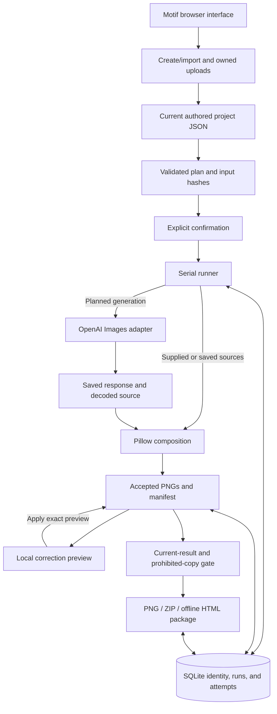

# Motif – Campaign Studio

**Version 0.2.0** · Native Windows, macOS, and Linux support · [Release notes](docs/release-notes.md)

Motif is a local creative-production application built as a simulated forward-deployed AI engineering exercise. It supports the producer workflow in the supplied customer scenario: reuse available imagery, deliberately generate a missing source, compose exact supplied wording and branding, and hand off campaign PNGs across products, formats, and markets. Planning, production, correction, and delivery stay connected.

The central decision is to **generate source imagery only when needed, then compose exact supplied copy and branding locally**. One product source can support two markets and three formats. A wording, crop, logo, or text-style correction reuses that source instead of buying another image generation.


## Evaluation materials

[The submission website](https://motif.brucebracken.com/) provides a visual overview of the workflow, architecture, and decisions. This README provides setup instructions and the detailed behavior reference.

The application includes two seasonal campaigns: Autumn Winds provides a completed key-free example; Bridle & Bough provides a deliberate missing-image generation journey. The [example and import guide](examples/README.md) distinguishes these campaigns from engineering fixtures.

[Download the latest version](https://github.com/brucebrackenjr/campaign-studio/releases/latest/download/motif-campaign-studio.zip) to install Motif locally. You can also [watch the walkthrough](https://motif.brucebracken.com/#walkthrough), [browse the source](https://github.com/brucebrackenjr/campaign-studio), or [read the verification notes](docs/verification.md).

## Contents

- [What the application demonstrates](#what-the-application-demonstrates)
- [Run locally](#run-locally)
- [Try a complete workflow without a key](#try-a-complete-workflow-without-a-key)
- [Create new imagery with your own key](#create-new-imagery-with-your-own-key)
- [The producer workflow](#the-producer-workflow)
- [Brief, copy, and asset contract](#brief-copy-and-asset-contract)
- [Exported files and examples](#exported-files-and-examples)
- [Architecture and data flow](#architecture-and-data-flow)
- [Stack and decisions](#stack-and-decisions)
- [Where prompts and pixels come from](#where-prompts-and-pixels-come-from)
- [Persistence, identity, and cleanup](#persistence-identity-and-cleanup)
- [Paid requests, Stop, and recovery](#paid-requests-stop-and-recovery)
- [Metrics and their meaning](#metrics-and-their-meaning)
- [Verification and development](#verification-and-development)
- [Troubleshooting](#troubleshooting)
- [Scope and limitations](#scope-and-limitations)
- [AI assistance and attribution](#ai-assistance-and-attribution)

## What the application demonstrates

Motif covers a campaign’s input, production, correction, and delivery stages. It is a local single-user prototype, with a browser interface and ordinary files that can be inspected outside the application.

The assessment separates minimum pipeline requirements from three optional bonus categories. Motif implements those categories with the following boundaries:

| Assessment area | Motif implementation | Scope |
| --- | --- | --- |
| Campaign brief | Campaign forms capture products, audience, and campaign message; JSON briefs define one or both supported markets. One to five products are supported; the included campaigns contain five and three distinct products. | Minimum: at least two products and the required brief information. |
| Asset reuse | Attach finished PNG or JPEG imagery and reuse it locally. A missing or damaged attachment never silently becomes a paid request. | Minimum: accept and reuse available assets. |
| Missing imagery | Explicitly choose generation for an absent source, review the plan, and confirm an image-model request. | Minimum: generate missing imagery. This path creates an invented concept, not a fidelity promise for an existing photographed product. |
| Three aspect ratios | Square **1080 × 1080 (1:1)**, Story **1080 × 1920 (9:16)**, and Landscape **1920 × 1080 (16:9)** PNGs. | Minimum: at least three formats. |
| Printed campaign message | Compose exact supplied English copy locally; Spanish (Mexico) copy can be supplied separately. | English is the minimum; supplied localization is an additional capability, without translation or language detection. |
| Local execution | A Python application serves the browser interface and CLI checks on the evaluator’s machine. | Minimum: a local CLI or app. No hosted service is required. |
| Organized delivery | Save a folder or ZIP organized by product and format, with language-specific PNGs, an offline HTML overview, and a manifest. | Minimum: clearly organized output files. |
| Documentation | Setup, inputs/outputs, decisions, assumptions, and limitations are explained here and in the linked references. | Minimum README and the requested comprehensive submission documentation. |
| Brand checks | Check supplied logo presence and approved text colors, with layout and rendering validation. | Optional bonus. |
| Legal content checks | Match configured prohibited phrases in printed headlines and CTAs and require correction or a deliberate rule change before export. | Optional bonus. |
| Logging and reporting | Retain attempt facts, output coverage, scoped estimates, provenance, and accessible descriptions; snapshot relevant facts in exported reports. | Optional bonus. |

Additional controls serve concrete production needs:

- **Direct composition editing** lets the producer move and resize the logo, headline, and CTA, adjust framing, and choose from two packaged fonts and brand-palette colors. Different image compositions need different placements to keep the product and wording readable.
- **Preview, Apply, and Cancel** let the producer inspect a local correction before replacing accepted output, while retaining the source image for further edits.
- **Request planning and source reuse** make the proposed generation work visible and keep copy or layout corrections separate from another paid image request.

These workflow assumptions come from the supplied scenario and hands-on prototype use, not external customer research. The prototype concentrates on producing and correcting assets.

The complete output count is:

**products × selected markets × 3 formats**

Two products and two markets produce 12 PNGs. Five products and two markets produce 30. Three products with English (United States) only produce nine. These are output counts, not paid-request counts: a campaign made entirely from supplied or verified saved sources needs no new image-generation request.

The trash button on each Workbench card shows the files Motif will remove and asks you to confirm the campaign.

## Run locally

### Requirements

- **Python 3.14.4**, as pinned in [`.python-version`](.python-version). The package supports the Python 3.14 series.
- **macOS, Linux, or Windows** with a writable folder on a local drive. On Windows, use a regular local folder under your account, such as `C:\Users\you\Motif`. If Documents is redirected into OneDrive or uses reparse points, extract to another local folder. On a Mac that syncs Documents with iCloud, extract Motif to a local folder outside iCloud Drive when using uv.
- A current desktop browser. Connected verification includes Chromium journeys at 1440 × 900 and 1366 × 768; this is not a mobile or universal browser certification.
- An OpenAI API key only if you choose to generate new imagery. It is unnecessary for local composition, corrections, exports, or the key-free checks below.

Download and extract [motif-campaign-studio.zip](https://github.com/brucebrackenjr/campaign-studio/releases/latest/download/motif-campaign-studio.zip). In Terminal or PowerShell, start in the directory containing the extracted Motif folder, then run:

```sh
cd Motif
```

This folder contains `pyproject.toml`, `uv.lock`, and this README. If you cloned the repository or used GitHub’s Code → Download ZIP, open the folder containing those files. Run either installation sequence below from that folder.

### Option A – locked uv environment

The documented installation was tested with **uv 0.13.6**, also pinned in CI. Install [uv](https://docs.astral.sh/uv/getting-started/installation/) if needed, then run:

```sh
uv sync --locked
uv run --locked campaign-studio serve
```

Open **<http://127.0.0.1:8000>**. Stop the server with **Control-C**. Keep one running application instance per data workspace.

For a simple server liveness check, open <http://127.0.0.1:8000/health>. It returns a small status response; it does not test provider credentials or establish that every campaign is valid.

### Option B – conventional Python environment

**macOS and Linux**

```sh
python3.14 -m venv .venv
.venv/bin/python -m pip install --require-hashes -r requirements.txt
.venv/bin/python -m pip install --no-deps --no-build-isolation .
.venv/bin/python -m pip check
.venv/bin/campaign-studio serve
```

**Windows PowerShell**

Run these commands from the same extracted Motif folder:

```powershell
py -3.14 -m venv .venv
.\.venv\Scripts\python.exe -m pip install --require-hashes -r requirements.txt
.\.venv\Scripts\python.exe -m pip install --no-deps --no-build-isolation .
.\.venv\Scripts\python.exe -m pip check
.\.venv\Scripts\campaign-studio.exe serve
```

From another directory, run `uv run --project 'C:\path\to\Motif' --locked campaign-studio serve` or `& 'C:\path\to\Motif\.venv\Scripts\campaign-studio.exe' serve`. No activation script is required.

[`requirements.txt`](requirements.txt) is exported from the same lock used by `uv`. It includes the pinned build dependency for the local package installation. There is no JavaScript package installation or frontend compilation step. Node is needed only for the developer JavaScript tests, which were run locally with **Node 26.7.0**.

### Choose a workspace or port

Motif keeps its code, installed environment, and default data together:

```text
Motif/
  .venv/
  src/
  Workspace/
    Campaigns/
      Autumn Winds-901f13e2/
        Brief/
        Assets/
        Runs/
        Exports/
    private/
      state.sqlite3
    smoke/
```

Campaign subfolders appear as their files are created. The `private` folder holds the shared database and application control files; `smoke` is reserved for installation checks and can be empty.

Both installation methods find this workspace from the installed environment. On macOS and Linux, to start from another directory, use `uv run --project "/path/to/Motif" --locked campaign-studio serve` or invoke `"/path/to/Motif/.venv/bin/campaign-studio" serve`. If you move Motif, recreate its .venv at the new location using either install sequence. Back up the whole Workspace folder together while the server is stopped. On macOS and Linux, keep the installation’s private .env separately if you want to retain its settings. Deleting the extracted Motif folder removes its local installation and default workspace. Explicit external workspaces and exports you saved elsewhere remain at their chosen locations.

To keep an evaluation separate from other work:

```sh
uv run --locked campaign-studio serve --data-dir ./motif-evaluation-data
```

To use a different port on any platform, set `CAMPAIGN_STUDIO_PORT=8001` in `Motif/.env` before starting the server.

The `--data-dir` argument takes precedence over `CAMPAIGN_STUDIO_DATA_DIR`; environment settings take precedence over values in `Motif/.env`. The data directory path must not pass through a symbolic link or Windows junction. Motif leaves earlier workspaces in place. The Python package, executable, and configuration prefix remain `campaign_studio`, `campaign-studio`, and `CAMPAIGN_STUDIO_*`.

Versions 0.2.x use the campaign-folder layout for fresh workspaces. To revisit an existing 0.1.x workspace, open it with its original Motif version. For a new project workspace, run `uv run --locked campaign-studio serve --data-dir ./motif-projects` from the installation folder. With Option B, add the same `--data-dir` argument to its installed executable.

If Motif reports a missing or incomplete workspace database, stop the app and restore the complete Workspace folder from backup. Its private/state.sqlite3 and Campaigns folder belong together.

## Try a complete workflow without a key

On its first launch into an absent or empty data directory, the official server command installs two ordinary campaigns before Home is ready. Autumn’s 30 finished PNGs are included in the package and copied with their editable sources, wording, and layouts. First setup does not render those images or make an API request.

| Included campaign | Initial state | Useful evaluation path |
| --- | --- | --- |
| **Autumn at Home** · Autumn Winds | Five products, English (United States) and Spanish (Mexico), and **30 completed PNGs**. Zero application requests. | Choose **Continue working**, inspect the images in Studio, make a local correction, and use Handoff to export. |
| **Winter at the Ranch** · Bridle & Bough | Three products and both markets; **18 planned outputs**. The **Brass sleigh-bell strap** concept is missing, and its one-request plan is unconfirmed. Zero application requests. | Open its Campaign or Production page to inspect the supplied assets and missing-image plan. Generating the missing concept requires your own key and separate explicit confirmation. |

The supplied seasonal imagery was prepared externally with built-in image generation. Autumn’s final PNGs were composed from those sources during package preparation. They remain editable through the normal Studio tools. Bridle does not start with 18 completed images.

Setup is once per fresh workspace, not whenever the campaign count reaches zero. Existing workspaces are not automatically populated, and deleting a bundled campaign does not bring it back. If setup is interrupted, the next launch resumes unfinished examples. Motif preserves examples you edited or deleted.

To work from your own inputs, use **Create campaign** or **Import brief** from Home. Supply product photographs and the copy for each market. Add a logo if the campaign uses one. A plan with no new sources can compose and export locally.

For a repeatable installation check, use a separate data directory:

```sh
uv run --locked campaign-studio smoke --data-dir ./motif-check-data
uv run --locked campaign-studio sample-run --data-dir ./motif-check-data
uv run --locked campaign-studio sample-run --products 3 --us-only --data-dir ./motif-check-data
uv run --locked campaign-studio sample-run --replay --data-dir ./motif-check-data
```

These commands write test campaigns or check artifacts into the selected directory. They do not call the provider.

| Command | What it establishes |
| --- | --- |
| `smoke` | Basic installed-resource, image, JSON, and SQLite operation using a labeled 128 × 128 geometric image. |
| `sample-run` | A synthetic two-product, two-market campaign, 12 outputs, a six-output local correction, and portable export. |
| `sample-run --products 3 --us-only` | The output matrix works for three products and one market, producing nine outputs. |
| `sample-run --replay` | Genuine saved imagery can be reused and corrected locally, with 12 outputs and zero new provider attempts. Historical generation remains separately identified. |

The geometric examples and saved-source replay are verification fixtures. They are separate from the two included seasonal campaigns and do not establish creative approval. See [the examples guide](examples/README.md). There is no special Open example shortcut in the application; ordinary saved campaigns appear in the Workbench.

## Create new imagery with your own key

For a product without an image, select **Generate new image** and describe the subject. Production shows the source requests, output count, request allowance, and estimate before confirmation. The current provider request sends the concept description, audience, and creative direction as text; this path does not upload supplied photographs or the logo.

If a key is missing, use **Add your OpenAI API key**. On macOS and Linux, the masked dialog saves the key in the installation’s private `.env`. On Windows it encrypts the key for the current Windows user and writes the ciphertext to `Workspace/private/openai-key.dpapi`. A successful save activates the key. If you move a Windows workspace to another account or computer, its campaigns remain editable. Enter a new key in Production when you need generation. **Saving a key does not test provider access, confirm a plan, or start generation.** Return to Production and make that separate choice.

Alternatively, configure `OPENAI_API_KEY` in the process environment before starting. On macOS and Linux you can also configure the installation’s private `.env`. An explicitly supplied environment value wins, including an empty value. In that case, update the launch environment and restart; the dialog explains that the environment manages the key. Manual edits to `.env` also require a restart. The launcher reads that one file, without parent-directory discovery.

To remove a saved key, stop Motif first. On macOS or Linux, remove the `OPENAI_API_KEY` entry from `Motif/.env`; on Windows, delete `Workspace/private/openai-key.dpapi`. Remove any separately configured `OPENAI_API_KEY` environment value as well, then restart.

No API key ships with the application. Keep credentials out of briefs, screenshots, exports, and source control. [`.env.example`](.env.example) documents the configuration names an evaluator may need. Missing or rejected credentials do not prevent working with intact saved imagery; ordinary validation and export rules still apply.

## The producer workflow

The four campaign pages are **Campaign → Production → Studio → Handoff**. Home contains the Workbench and **Continue working**, which opens the most recently saved ordinary campaign. Opening a campaign does not manufacture new save activity.

### 1. Campaign – establish the campaign

Create or import a campaign, then set its name, audience, creative direction, supplied headline/CTA copy, and brand palette. Attach a logo in Brand if you want it on the images. JSON briefs define the included markets; both bundled campaigns include English and Spanish. The subtabs are Brief, Products, Brand, and Copy & Rules. Campaign previews provide feedback while editing; they are not a claim that production has already happened. An imported brief opens here. In Products, attach each named photo when you have it. You can return to the Workbench and pick up the campaign later.

After images exist, use **Update Images** in Brand to apply a logo or campaign color change to those images locally. This makes no AI request. Leaving Brand with unapplied changes offers **Update and continue**, **Discard and continue**, or **Stay on Brand**. The default text color applies to text that inherits it; custom colors chosen in Studio remain unchanged. When the preview uses custom colors, **Use default for this image** restores inheritance for that product, market, and format.

Ordinary campaign fields autosave through the shared project queue, including unfinished values. Routine Save/Saved indicators are omitted; real save failures and conflicts still identify the problem and recovery action. Product-dialog changes commit through Add/Update, and image-editor changes through Apply. Saving authored work does not render new images or spend an API request.

### 2. Production – inspect and confirm the work

Add or edit up to five products from Campaign’s Products subtab or Production. Both open the same product editor. Choose an existing image or describe a new image to generate; the description works with the campaign direction. **Add product** or **Update product** commits the changes through the campaign’s save queue. Cancel, ×, and Escape discard uncommitted product edits. Switching image modes keeps the open dialog’s fields and selected photo, without saving them. Committed photos remain available when returning from generation mode. Existing campaign images stay unchanged until explicit production or Studio Apply.

In Campaign, click a product photo or image-state tile to edit it; the Edit image caption appears on hover and keyboard focus. The card’s remove button opens a confirmation before removing the product. At five products, Add remains available and explains how to remove or edit an existing product. A committed product without an image says **Image will be generated.** when generation is selected; saving it does not send a request.

Production prepares the plan and estimate automatically. Check the request count and estimate, then choose **Generate campaign images**. When OpenAI is needed, review its prompt and data-transfer details here. Progress and completion remain on Production; choose **Next: Studio** when ready. Known invalid input, unusable assets, text-fit problems, or prohibited copy must be corrected at the relevant action boundary.

The confirmed request uses fixed inputs and settings. Changing relevant inputs before dispatch requires a fresh plan. If a run is already underway, it finishes its confirmed snapshot while you can save newer ordinary project work separately.

### 3. Studio – correct the actual images

Studio displays the rendered PNGs. Open a product to keep its image in one workspace: tools are on the left, the canvas is in the center, selected-tool controls are on the right, and the three formats are below the canvas. Inspect opens first. Choose a market and format, then select a tool:

| Control | Scope and behavior |
| --- | --- |
| Inspect | Save an accessible description and inspect factual source provenance. These are not approval markers or a review-status workflow. |
| Framing | Zoom in and drag the photo to reframe it, or use the horizontal and vertical position sliders. Optional important-area bounds constrain crops; the guide is not drawn into exported pixels. |
| Logo | Move or proportionally resize the logo for the selected output. Replacement is a separate campaign-wide action with an explicit affected scope. |
| Text | Select **Headline** or **Call to action** to edit its wording, font, palette color, position, and size together. Wording changes affect the selected product and market across three formats; each field’s **All products** checkbox extends only that wording to other products in the market. Font, color, and geometry remain specific to the selected product, market, and format. Choose Noto Sans Regular or Barlow Condensed Semibold; drag the text to move it, and pull a corner or use the keyboard to resize it. |

Checking **All products** is explicit field intent: if other products differ, the displayed value can be propagated without fake typing. Untouched unchecked fields and other languages remain unchanged. A wholly unchanged target set is a no-op. If an intended target lacks the source material needed for correction, the application refuses the scope rather than silently skipping that product or generating a replacement.

Text, framing, and logo changes remain temporary until **Apply**. Text submits wording and appearance as one candidate and validates every wording-affected output before publication. Apply requires the current settled preview and keeps the same tool, controls, and selected text block in place while adopting the saved image. **Cancel** discards the current transient edits and returns to Inspect; it does not undo an earlier successful Apply. Escape first belongs to an active gesture or nested dialog, then follows Cancel. Switching tools, formats, or markets, or leaving the workspace with changes, offers **Apply and switch**, **Discard and switch**, or **Keep editing**. A failed Apply keeps the draft and current target. Dragging gives immediate local feedback while the exact preview loads. Further gestures on that same text block remain available; wording or font changes wait for updated measurements. Apply waits for the current validated preview.

### 4. Handoff – export the accepted result

Download individual images or create a complete ZIP/folder. For a generation failure, a partial package may contain the available valid outputs and clearly record omissions. A zero-image result cannot produce an image package.

**Configured prohibited wording is a campaign-wide export gate.** A match anywhere in the current output coverage blocks ZIP, folder, individual, partial, and application-served existing-package downloads. It is not bypassed by choosing another image. The correction message identifies the phrase, product, language, and printed field, with a direct action into Studio or the relevant Campaign or Production field. Correct the text, or deliberately change the rule, then Apply/Recheck.

Saved invalid or unapplied rule changes also prevent export until resolved. Unrelated unfinished brief copy and canceled editor scratch do not replace the copy already printed in accepted images. Image display remains available for correction. Previously downloaded external packages remain independent files.

## Brief, copy, and asset contract

The authoritative input contract is [the generated JSON Schema](docs/brief.schema.json), backed by the Pydantic models in [`brief.py`](src/campaign_studio/brief.py). [The brief reference](docs/brief-format.md) explains the complete format and source roles. Unknown fields are rejected. For demonstration photos, provenance describes how the imagery was made; the `synthetic` flag is reserved for labeled test fixtures, not a claim about whether a photograph was AI-created.

| Input | Important behavior |
| --- | --- |
| Campaign | Lowercase hyphenated UUID string, editable name, audience, creative direction, brand, included markets, and one to five products. Create/import allocate a new campaign identity. Names need not be unique. |
| Brand | An optional logo, a palette of one to eight colors, and a text color from that palette. Select **Require a logo on final images** for campaigns that must carry one. Otherwise, Handoff flags its absence and lets you export. Completed six-digit hex values are normalized; unfinished form text is preserved as authored work. |
| Market copy | Required `message` and optional `cta`, supplied independently for `en-US` and `es-MX`. No translation, language detection, or language certification. |
| Product copy | Optional field-level `copy_overrides`. An omitted field inherits; `cta: null` deliberately clears the optional CTA. A required message cannot be cleared. |
| Phrase rules | Optional configured phrases with literal or whole-word matching and optional case sensitivity. All matches block; there is no advisory severity. |
| Source | `finished_scene` for an attached image, or `concept` with `imagery_absent: true` and a generation description. JSON import also accepts `prepared_product` for a transparent cutout composited over a generated background; the product editor does not offer that route. See the [source constraints](docs/brief-format.md#sources-and-framing). |

For example, this **market-content fragment** configures an ordinary whole-word prohibition; it is not a complete brief:

```json
{
  "copy": {"message": "Made for the next outing", "cta": "Explore the collection"},
  "phrase_rules": [
    {"id": "absolute-claim", "phrase": "guaranteed", "match": "whole_word", "case_sensitive": false}
  ]
}
```

Matching uses Unicode normalization and the configured literal/word-boundary semantics. It scans accepted printed headlines and CTAs, not generation instructions or arbitrary descriptions. It is a simple configured-text check, not a legal-compliance engine.

Structurally valid prohibited content can still be imported, opened, edited, and saved. Validation occurs when the producer asks to plan, produce, apply, or export. A prohibited phrase does not make the campaign impossible to open for correction.

### Asset handling

- Upload **PNG or JPEG**, up to **20 MiB per file** and **40 megapixels**. Logos may be opaque or transparent; a fully transparent logo is refused.
- The server inspects the decoded content, applies orientation, and handles supported color profiles. Original source files are retained. A filename or MIME label alone is not proof that an image is usable.
- Imported asset paths do not grant filesystem access. Reattach the corresponding assets through the image and logo controls; imports do not read arbitrary paths from another machine.
- Replacement failure preserves the previous usable logo. Basic provenance remains factual; replacing an image does not establish ownership or inherit an unsupported rights claim.
- Per-output geometry is normalized against the actual source or output canvas. Text uses measured glyph bounds, not just an invisible selection rectangle. Intentional text/logo overlap is allowed; the producer remains responsible for readable composition.

## Exported files and examples

A package contains only the selected valid image files, its manifest, and the offline overview. Its layout is:

```text
Autumn Winds-a1b2c3d4/
├── index.html
├── manifest.json
└── images/
    └── Leaflight lantern/
        ├── English (United States)/
        │   ├── Square - 1080x1080.png
        │   ├── Story - 1080x1920.png
        │   └── Landscape - 1920x1080.png
        └── Spanish (Mexico)/
            └── ...
```

The ZIP and its extracted root use the brand name and a short snapshot suffix, such as `Autumn Winds-a1b2c3d4`. Folder exports use the same name. Product names stay readable; unsafe characters are replaced, long names are bounded, and duplicate names receive stable suffixes. Individual PNG downloads include the product, market, format, and dimensions.

Exports include the available images from the current saved revision. Missing outputs are recorded as omissions rather than represented by invented files. The manifest records the output matrix, dimensions, file hashes, actual supplied copy, source provenance, accessible descriptions, omissions, and relevant metrics. It does not include API credentials or raw provider responses.

Extract the ZIP, then open `index.html` in a browser. Keep the folder structure together when moving it. Images use relative references; the overview needs no running Motif server, API key, external font service, or network connection. The manifest is useful for programmatic inspection, while the HTML provides a readable handoff.

The overview labels these same formats Instagram post (Square, 1:1), Story (9:16), and Facebook post (Landscape, 16:9).

Packages capture their image and description/metadata snapshot. A later change produces a new artifact instead of rewriting a previous download. An intact identical package can be reused; matching only the image revision is insufficient if its descriptions or report facts changed. Export rechecks named file hashes and current wording admission. The browser report uses a UUID address. Its saved image and metadata snapshot, internal fingerprint, and permitted files remain bound in the export registry; the fingerprint is not part of the browser URL.

**Import another seasonal campaign.** The [Autumn brief and assets](src/campaign_studio/resources/campaigns/autumn-winds/) and [Bridle brief and assets](src/campaign_studio/resources/campaigns/bridle-and-bough/) are included in the Motif folder. Choose **Import brief**, select the campaign’s `brief.json`, and attach its named product images and optional logo through their controls. Import opens Campaign so you can fill in the remaining details at your own pace. Each import receives a fresh identity, even when its display name matches another campaign. Motif imports JSON; a ZIP exported from Handoff contains finished outputs and is not an import brief.

## Architecture and data flow

Motif is one local Python process serving a browser interface. The browser handles interaction; Python remains authoritative for validation, pixels, state transitions, and export.



Three states are deliberately distinct:

1. **Authored project** – what the producer is currently writing, including unfinished values.
2. **Confirmed plan** – the fixed input and request snapshot authorized for a production run.
3. **Accepted output** – the images and metadata that Studio and Handoff currently use.

This prevents an unfinished draft, a new unstarted plan, or a failed Apply from displacing useful accepted images. An explicit rule decision can legitimately withhold every output; preserved fallback pixels do not override that decision’s export restrictions.

The server binds to loopback and checks allowed hosts, request origin, a per-process mutation token, file ownership, and expected versions. Motif assumes a trusted local computer and does not authenticate individual operating-system accounts. Campaigns and supplied assets remain on the machine except for text deliberately sent in a confirmed concept-generation request.

The canonical campaign pages are `/campaigns/<uuid>/campaign`, `/production`, `/studio`, and `/handoff`, all beneath the same campaign prefix. A malformed, unknown, or deleted identity receives the Motif **Campaign not found** page. A registered draft can open before its first run. Old page aliases and old-schema migrations are not part of this prototype.

## Stack and decisions

Alternative entries are explanatory architectural comparisons. Only the selected stack is implemented here.

| Choice | Reason | Alternative and trade-off |
| --- | --- | --- |
| Python 3.14 | Keeps validation, image work, file handling, and the provider integration in one language. | A TypeScript backend could unify browser/server language, but would require a different image stack. Python means maintaining the browser/server command boundary explicitly. |
| FastAPI, Uvicorn, and Pydantic | Typed input contracts and explicit local HTTP operations, with generated JSON Schema. | A CLI alone would simplify presentation but make visual editing harder. A larger service framework is unnecessary for one local producer. |
| Jinja2 and plain JavaScript | A served page shell and direct controls without a frontend build or dependency tree. | A frontend framework could help a larger interface, but adds tooling. Plain JavaScript still requires careful ownership of async state, focus, and stale responses; it is not automatically simple. |
| Pillow and fontTools | Deterministic local crop, font coverage, text metrics, overlays, and PNG output. | Rendering text inside a generated image would make exact copy changes unreliable. Browser-only drawing would need a second authority for final pixels. |
| SQLite plus files | Short transactions protect identities and attempts; image files and packages remain inspectable. | Cloud object storage and a shared database suit multi-user hosting, but add services and operating concerns outside this local workflow. There is no S3 or simulated S3 layer. |
| One serial runner | Clear allowance accounting and bounded local resource use without a task queue. | Parallel generation could improve throughput but would complicate Stop, cumulative allowance, and partial failure. Serial execution trades speed for a smaller execution model. |
| Official OpenAI SDK with one small adapter | Keeps provider transport separate from planning and rendering without building a general provider framework. | Another provider would need its own parameter, error, cost, and image-quality verification. Provider interchangeability is not claimed. |
| `uv.lock` and a hashed requirements export | Reproducible development and a conventional evaluator installation from the same dependency set. | Two independent dependency lists would be easier to drift. The export must remain synchronized with the lock. |
| Offline HTML and PNG delivery | The recipient can inspect the actual images without installing the application or sharing a key. | A hosted team-review system could coordinate approvals, but would require accounts, access control, and synchronization absent from this prototype. |

The stack is small; the interactive workflow is still substantial. Save conflicts, paid-request uncertainty, exact-preview Apply, and safe deletion are real responsibilities. Their guards are kept explicit rather than replaced with a claim that the whole application is trivially portable or production-ready. [Architecture notes](docs/architecture.md) explain these choices and their boundaries.

## Where prompts and pixels come from

### Generation prompt and request

The saved generation request assembles a predictable prompt from the concept description, audience, and creative direction, adds photographic/composition instructions, and asks for no text or logo. Important subject content is requested inside the central region needed by the local crops. A prompt is guidance, not proof that the resulting image will respect every crop.

The configured snapshot is `gpt-image-2.5-flare-2026-09-08`, requesting one high-quality, opaque, **1920 × 1920 PNG**, with zero automatic retries and a **120-second overall deadline**. These settings are part of the plan digest. Access depends on the evaluator’s account; this README does not claim universal model availability or a newly verified current price.

The image-generation request is the provider network boundary. The delivered concept path sends text. Existing product photos, logos, exact advertising text, and local editor adjustments are handled locally. Motif has no prompt-writing agent or natural-language brief orchestrator.

### Copy, logo, and final composition

The local compositor handles image loading, crop geometry, text wrapping, glyph bounds, proportional logo placement, and final composition. It draws the supplied text after imagery exists. There is no implicit translation, shortening, rewriting, or disclaimer insertion.

The two packaged output families are **Noto Sans Regular** and **Barlow Condensed Semibold**. Each headline and CTA can select its own family and palette color. Default typography and color apply when no override exists. Font upload, system-font enumeration, arbitrary editor colors, rich text, and effects are outside scope.

Temporary previews and accepted PNGs use the same compositor. Publication saves the checked images and their manifest. The browser may display clean image layers while a handle moves, but Apply is tied to the settled decoded final PNG and its request identity. Selection frames, guides, and handles do not enter the exported image.

## Persistence, identity, and cleanup

Motif uses one continuously saved project, not a version-history product. Quiet autosave and deliberate product commits share version-checked authored persistence. A stale browser tab cannot silently overwrite a newer save; a lost acknowledgement can be reconciled without treating a repeated request as a different edit.

Campaign identity is a canonical hyphenated UUID, separate from its display name. SQLite records the full campaign ID and its permanent project folder before production. Duplicate names are allowed, and renaming leaves the identity and URL unchanged. Draft content stays in JSON; the registry does not duplicate creative content.

The workspace holds uploads, source snapshots, received material, execution records, accepted PNGs, and app-created packages. Keep a backup of the complete Workspace folder before replacing or deleting the extracted Motif installation.

Open `Campaigns/` in the workspace to find a folder for each campaign, such as `Autumn Winds-901f13e2/`. The label comes from the brand or campaign name at creation. The suffix identifies the project. Renaming a campaign keeps its folder and links stable.

| Inside a project | Contents |
| --- | --- |
| `Brief/` | The editable draft and the original imported JSON, when supplied. |
| `Assets/` | This project’s copies of uploaded product photos and logos. |
| `Runs/<id>/` | The production plan, frozen inputs, request records, received source images, and revisions with finished PNGs. |
| `Exports/` | Managed delivery ZIPs and offline report folders. |

One SQLite database in `private/state.sqlite3` records every campaign’s identity, production state, attempts, descriptions, and managed file locations. Pick the same photo in two campaigns and each receives its own copy. Back up the whole workspace, including SQLite, with Motif stopped.

After successful image publication, exact cleanup retains the newest usable output set and a distinct necessary complete fallback. Source imagery, small records, and independent exported packages remain available. Empty failures do not replace usable images. Startup resumes only a previously confirmed cleanup with its existing target list; it does not choose additional files to delete.

**Delete campaign** lists the registered files and estimates the space to reclaim. Confirmation removes those files and the empty project folder. A file you added yourself keeps its folder on disk. Packages you copied elsewhere remain available. An interrupted deletion resumes its confirmed file list after restart or retry.

### Capacity

The default growth budget is **10 GB**, with a **1 GB free-disk reserve**, both decimal units. [`.env.example`](.env.example) exposes the byte-valued configuration. **Local workspace**, or the command below, reports the resolved location, measured usage, and free space:

```sh
uv run --locked campaign-studio workspace
```

Large uploads, snapshots, image publications, packages, and paid attempts check conservative disk estimates. Received provider material and essential control records are preserved when possible even if a result exceeds its estimate; subsequent growth can then be refused. Intact existing work remains usable, subject to the ordinary wording and integrity gates.

This is disk admission, not an operating-system quota, a RAM limit, or a guarantee against another process filling the disk. Large compressed inputs can require much more memory when decoded. No automatic destructive retention policy substitutes for deliberate campaign deletion.

## Paid requests, Stop, and recovery

The saved plan records the exact request. Confirmation binds its digest and allowance. Immediately before dispatch, the runner reserves an attempt durably, rechecks relevant state and capacity, and then calls the provider outside the short database transaction.

- **No automatic paid retry.** The SDK has retries disabled. A retry is an explicit producer action against the saved run, request, and remaining cumulative allowance.
- **Stop prevents unsent work.** It cannot promise that a request already accepted by the provider was canceled or uncharged.
- **Returned material is saved before local decoding/composition.** Usable usage metadata is retained even if image decoding or later local writing fails.
- **Local recovery reuses saved material.** It applies only to genuinely started work with verifiable saved sources/responses. It cannot start an unconfirmed plan under the name of recovery.
- **Unknown outcomes stay unknown.** A timeout or lost connection is not evidence of a free request. Failed and uncertain attempts remain part of the record and allowance.
- **Duplicate starts and stale operations are refused.** Following current progress is a read; another click is not permission to dispatch again.

The application distinguishes a missing image source, a usable received response, a provider failure, and a local composition failure so the remedy can fit the actual condition. See [provider and recovery notes](docs/provider.md).

## Metrics and their meaning

Completed run records and current output coverage show what was produced; the workspace campaign count also includes drafts. Processing time, source reuse, attempts, and cost provide evidence of production efficiency. Quantifying time saved requires a measured manual baseline for the same campaign and output scope.

| Metric | What it measures |
| --- | --- |
| Planned outputs | Product × market × format combinations in the current plan. |
| New planned requests | Missing concept sources requiring generation; independent of output count. |
| Attempt allowance and history | Dispatch attempts in the saved run, including failed or uncertain attempts. |
| Campaign attempts | Durable attempts across the campaign’s runs, retained across switching, reopening, and restart. |
| Plan estimate | An estimate for new planned requests using saved settings and dated pricing assumptions. |
| Usage-based estimate | A calculation from reported usage for recorded attempts; it is not an account charge or invoice. |
| Current output coverage | What is currently available, missing, or withheld, separate from plan size and historical requests. |
| Operation timing | The local operation being reported; it is not an end-to-end agency time-saving or ROI claim. |
| Workspace usage | Measured disk use and the admission budget, not generation cost or process memory. |

[`costing.py`](src/campaign_studio/costing.py) contains the dated pricing basis and calculation. Zero new calls displays `$0.00` for that scope. Missing usage or unverifiable pricing produces an incomplete estimate with a reason; any known subtotal is labeled as a partial amount. A failure does not erase a known count or usable returned usage. Exported reports snapshot the facts at creation and do not silently change when later work occurs.

## Verification and development

From the repository root:

```sh
uv sync --locked
uv run --locked ruff check .
uv run --locked ruff format --check .
uv run --locked pytest
node --test tests/*.test.cjs
```

Then run the isolated smoke, synthetic, and saved-replay commands above. JavaScript tests use Node’s built-in test runner and no npm package dependencies; the recorded local run used Node 26.7.0.

| Evidence type | What it proves, and what it does not |
| --- | --- |
| Python tests | Deterministic validation, source/copy handling, image composition, storage, identity, export, provider-transport failures, and durability cases. Mocked transport is not live provider generation. |
| JavaScript tests | Controller, editor, event, stale-response, and presentation behaviors. They do not replace actual browser interaction. |
| Connected browser journeys | Create/import, attachments, local production, autosave, Add/Update, Apply/Cancel, failure recovery, and actual exports within recorded viewport/input coverage. Finite journeys do not prove every possible control state or platform. |
| Package verification | Actual file counts, dimensions, file hashes, decoded pixels, and moved offline reports, rather than screenshot-only proof. |
| Installation checks | Locked dependency and conventional package installation, resource parity, and key-free smoke. A successful installation is distinct from provider-account access. |
| Genuine generation | Separately recorded actual provider work. Replaying its saved source proves reuse, not a new call. |

Verification includes deterministic tests, controlled provider failures, actual desktop browser journeys, clean installations, and inspection of exported PNGs and offline reports. [Verification notes](docs/verification.md) distinguish what was run on the current package from unchanged evidence carried forward. Saved-source replay is not a new provider call, and test totals are not a quality score.

The [GitHub Actions workflow](.github/workflows/checks.yml) runs the full application checks on Ubuntu. A native Windows job runs the full Python suite, including storage, encrypted credentials, and bundled campaigns, followed by installed sample commands. [Workflow runs](https://github.com/brucebrackenjr/campaign-studio/actions) show results for each commit.

Useful focused test groups include:

- `test_campaign_identity.py`, `test_authored.py`, and `test_process_durability.py` – identity, stale/lost saves, and actual process boundaries.
- `test_provider_runner.py` and `test_production_disclosures.py` – request intent, Stop, allowance, failures, and useful recovery state.
- `test_direct_editing.py`, `test_partial_editing.py`, `test_logo_editing.py`, and `test_rule_decisions.py` – exact correction scopes and accepted-result behavior.
- `test_prohibited_exports.py`, `test_offline_report.py`, and `test_cleanup.py` – whole-campaign export admission, portable reports, exact deletion, and interrupted cleanup.

### Debugging a local run

- **Production or provider failures:** Start with the reported state and recovery action in Production. SQLite retains request-attempt records; saved plans and any retained provider responses supply the corresponding request and outcome evidence. Use these together before deciding whether another request is appropriate.
- **Browser behavior:** Use the browser’s Network panel to inspect the affected local request, status, and error response, and its Console for unexpected JavaScript errors.
- **Startup or server errors:** Check the terminal that launched Motif for startup messages and unexpected exceptions.

## Troubleshooting

| Symptom | Appropriate next step |
| --- | --- |
| Python or dependency installation fails | Use Python 3.14.4 and the locked commands above. Do not combine independently chosen package versions with the supplied lock. |
| Port 8000 is occupied | Open the existing instance if it is the intended workspace, or choose another `CAMPAIGN_STUDIO_PORT`. Do not start two instances against the same workspace. |
| A key was saved, but generation is unavailable | Saving proves local persistence only. Inspect the specific access, billing, rate-limit, or connection message. If the launch environment controls the key, update it and restart. |
| Saving a key fails | On macOS and Linux, use an installation folder owned by your account and keep the .env file private. On Windows, sign in with the account that saved the encrypted key. Use a regular local folder without symbolic links or junctions, and check free disk space. |
| Imported images are missing | Attach the matching product photograph in Campaign or Production, or the logo in Campaign. A JSON path is not permission to read an arbitrary local file. |
| The image chooser starts in another folder | The browser/operating system chooses the native file dialog’s starting folder. Browse to the intended file; Motif cannot force this ordinary picker into a campaign directory. A previously committed photo remains available when switching back from generation mode. |
| A logo upload is refused | Use a decodable PNG/JPEG within the size limits and with visible artwork. An unsuccessful replacement should leave the previous usable logo in place. |
| Text or a protected source area does not fit | Adjust the actual copy, text layout, crop, or important-area bounds. Motif does not silently truncate copy or relax the constraint. |
| Export asks for a wording correction | Use the direct correction action for the named product/language/field, or deliberately edit the applicable rule. Apply/Recheck; selecting an unblocked subset cannot bypass the campaign gate. |
| Export says rule changes are pending | Resolve and apply the saved rule edits. A saved form is not an accepted rule decision. |
| Another tab changed the campaign | Preserve the current text, then use the conflict/reload path. Do not keep resubmitting an old base as if it were current. |
| A request timed out or the connection failed | Inspect the saved attempt and recovery option. Do not assume there was no charge or immediately repeat the request. Local recovery is appropriate only when usable material was saved. |
| A saved output is damaged | Use offered local recovery when its verified sources remain. If the source itself is missing or changed, reattach a valid source; Motif will not buy one silently. |
| New work is refused for storage capacity | Inspect Local workspace, free disk space, or deliberately delete an unneeded campaign. Configuration changes require restart. Existing intact downloads still require current content admission. |
| A campaign link is not found | Return to the Workbench or create a campaign. Display names are not URL IDs; old route/ID aliases are not supported. |
| An offline report has missing images | Extract the whole package and move its HTML, manifest, and images together. Do not open only a detached `index.html`. |
| A bundled composition font is missing or corrupt | Restore/reinstall the complete package before new rendering. Existing saved PNGs do not need to be generated again just to view them. |

## Scope and limitations

- **Local and single-user.** No cloud account, multi-user permissions, collaborative approvals, hosted deployment, ad-platform publishing, or scheduling.
- **Supplied localization.** English (United States) and Spanish (Mexico) are separate supplied texts. The application neither translates nor determines whether text is actually written in the selected language.
- **Bounded imagery.** Finished-image reuse and explicitly invented concept generation are supported. JSON import and the underlying service also accept a prepared transparent product cutout for composition over a generated background. This route is not offered by the product editor, has no adjustable framing, and has not been verified with a live provider request. It is not a fidelity guarantee for an existing commercial product.
- **Deliberate editing.** Headline and CTA have independent font/palette controls, but there is no arbitrary font upload, free color picker in the image editor, rich text, effects, rotation, or layer-order tool. Brand owns the palette.
- **Simple configured legal check.** Prohibited-phrase matching is not legal advice, trademark clearance, fact-checking, or comprehensive compliance review.
- **No approval workflow.** There are no human-review status markers, warning-center tasks, history controls, fixed version allowance, or saved image-editor draft queue.
- **No automatic retry or model switching.** Provider failures require deliberate decisions. Account access, response time, output quality, and exact charges are not guaranteed.
- **No legacy migration promise.** This prototype uses its current schema and supported routes. It does not upgrade incompatible old test workspaces.
- **Technical correctness is not creative approval.** Correct dimensions, exact text, and verified files do not establish an effective campaign. Crop/readability judgment, asset permission, and publication remain human decisions.

## AI assistance and attribution

The application, tests, and documentation were developed with OpenAI Codex assistance. Claude Code was used for independent code and browser review, and AI-assisted design work informed the interface. Product scope, trade-offs, and acceptance remained human-directed. This disclosure describes the development process; Motif itself is not a multi-agent application.

Generated or synthetic imagery must remain identified in its provenance. A saved image replay is not presented as a fresh generation, and an AI-generated product concept is not a photograph of a verified commercial product. The selected seasonal source images were prepared with built-in image generation outside Motif. Their application setup records remain zero-call; Bridle’s included starting plan still requires deliberate generation of its missing concept. The [third-party notices](THIRD_PARTY_NOTICES.md) identify the included imagery and font origins.

The bundled fonts retain their SIL Open Font License notices: [Noto Sans Regular](src/campaign_studio/resources/fonts/OFL.txt), [interface Noto Sans](src/campaign_studio/static/motif/assets/NotoSans-OFL.txt), and [Barlow Condensed](src/campaign_studio/static/motif/assets/Barlow-OFL.txt). Dependencies retain their own licenses. [Third-party notices](THIRD_PARTY_NOTICES.md) must accompany distribution.

No license grant for the original project code is specified in this snapshot. The bundled fonts and dependencies retain their own notices and terms; those terms do not grant a license to the original application code.
