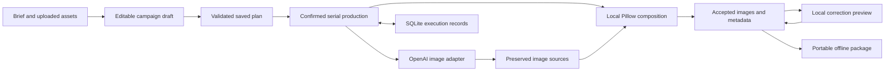

# Architecture

Motif is one local Python application with a browser interface. FastAPI serves explicit operations, Jinja2 supplies the Motif page shell, and plain JavaScript manages controls and progress. Python owns validation, production, actual image pixels, persistence, and export.

## Responsibilities

| Component | Responsibility |
| --- | --- |
| Browser workflow | Collect campaign input, hold temporary editor changes, and display the server’s plans, previews, progress, and results. |
| Input and planning | Validate the brief and assets, resolve supplied wording, determine output coverage and source reuse, and bind the proposed request settings. |
| Local image production | Crop sources, compose exact text and branding, preview corrections, and publish checked PNGs. |
| Provider adapter | Send only confirmed image-generation requests, preserve returned material, and report failures without automatic paid retries. |
| State and storage | Preserve authored JSON, SQLite relationships and execution facts, owned assets, accepted outputs, and exact cleanup targets. |
| Handoff | Check current content and file integrity, then deliver images and a portable offline package. |

The browser does not simulate successful production. It displays the server's actual plans, progress, saved images, and actionable failures. Exported PNGs are the visual truth, and local previews use the same image composition services.

## One campaign through the system

A campaign has a lowercase hyphenated UUID string separate from its editable name. `campaigns(id TEXT PRIMARY KEY)` registers identity before any run; `runs.campaign_id`, file ownership, and cleanup intents have foreign keys to it. Create and import publish a new draft and registration under the draft lock and one database transaction; failures remove only the newly published file. GET and ordinary Save never register unknown folders or IDs.

The draft JSON holds one current authored envelope, its version, and the last acknowledgement. Quiet campaign autosave and deliberate product commits use the same operation and retain incomplete fields, unrelated form buffers, and context. Failures and conflicts retain actionable recovery. Stale tabs pause, and an exact retry can acknowledge a lost response without adding another save. Shape, size, and attachment-ownership checks protect saved input; production validation remains separate.

Image-editor drafts stay outside that envelope until explicit Apply. Studio keeps one product canvas visible while Text, Framing, Logo, or Inspect controls occupy its side panel. The [Studio behavior reference](../README.md#3-studio--correct-the-actual-images) defines Apply, Cancel, and navigation. Ordinary Handoff wording corrections return to their origin, while an explicit Apply-and-switch follows the chosen destination. Project saves do not render images.

The product dialog also holds one transient draft, separate from campaign autosave. Add/Update commits it through the same queue; Cancel, ×, and Escape discard it. Source-mode switches and upload completion update only that open dialog. Upload responses must still belong to its current campaign and editor. Committed retained-photo references remain in `form_drafts.product_images` with ownership validation; product scratch fields and reopen context are not saved. Campaign and Production source inspection use the current stable product ID, while Studio source inspection remains tied to accepted imagery.

The official launcher recognizes a genuinely absent or empty data directory before initializing storage. It claims bundled setup with a create-only receipt under the runner lock; this decision never depends on campaign count. Curated asset hashes are checked before import, each campaign receives a fresh UUID, and source images and logos are copied through ordinary owned upload handling.

Autumn’s finished PNGs and build-time pixel checks are packaged with a versioned descriptor bound to its exact brief and source hashes. Setup validates that contract against a fresh local plan, copies the verified PNGs into a new owned revision, and publishes through the ordinary state layer. It imports no database or provider history and performs no composition. Sources, wording, and layouts remain available for later editing and recomposition. Bridle remains planned and unconfirmed. Interrupted setup preserves ordinary campaign records, fails that startup, and is not repeated on a later launch. The receipt survives campaign deletion. Injected application instances do not seed unless explicitly requested.

Maintainers refresh the fixed Autumn outputs with `uv run --locked python scripts/build_bundled_outputs.py` from the source directory. This uses a temporary workspace and the ordinary local renderer, then updates the PNGs and descriptor hashes. A changed brief or source without a matching prepared bundle is refused at installation.

Production prepares a local plan when needed on entry or after a relevant committed edit. Planning resolves shared copy and per-product overrides, verifies sources, constructs every product/market/format output, and determines which image requests are necessary. A delayed response cannot replace newer authored work or another campaign’s displayed estimate. Failed preparation waits for a relevant edit or an explicit retry.

The deliberate Generate action binds the displayed saved plan’s digest, including relevant input hashes and request settings. Automatic preparation never dispatches production. Changing relevant authored brief inputs invalidates an unstarted plan. An already dispatched run finishes its fixed snapshot while newer authored work can still be saved. Planning validates the current authored brief and never falls back to an older valid projection.

Before dispatch, the runner commits an attempt record in SQLite. Network work happens outside that short transaction. It preserves the returned response before decoding and composing images. Stop prevents unsent work; it does not promise to cancel a request already accepted by the provider.

Corrections reuse saved imagery. A local preview is temporary and tied to its draft and base revision. Explicit Apply writes a new revision and retains unchanged images in the complete set. Per-field product scope is explicit, and unavailable intended targets are refused rather than skipped. The storage policy below describes which output files are retained after publication.

Logo editing uses the same revision and preview services. `Workspace.logo()` resolves the selected placement or the full available replacement set, and `Runner.revise()` verifies that exact proposal before publishing. The browser uses clean server-produced photograph and copy layers while arranging, then requires the decoded final PNG and its digest before Apply. A small private revision receipt reconciles a lost image-application response without resending; portable exports omit it. Replacement updates the canonical logo reference while preserving unrelated draft edits and partial omissions.

`Workspace.text()` accepts Headline/CTA wording and per-field product scope together with placement/style commands in one candidate brief and one preview/Apply transaction. Wording spans the selected market’s three formats, while geometry changes only the selected product, market, and format. It validates every wording-affected output, including its required source inputs. Crop and logo changes remain separate operations.

The font registry uses the packaged Noto Sans Regular and Barlow Condensed Semibold assets. The compositor supplies measured glyph bounds, a clean base, separate block layers, and an exact final preview; visible-reference checks subtract later layers. The browser shares pointer/keyboard mechanics between text and logo but keeps font reflow and logo proportions separate.

The current interface exports applied images and verifies named image hashes. Temporary editor changes do not enter a package until explicitly applied. The current campaign projection uses `State.current_output()` directly. Internal revision records remain for exact guards, ancestry, and recovery. The package captures a coherent snapshot of accessible descriptions and provenance. It contains relative local assets, so moving the extracted folder does not depend on the app’s original storage paths.

## Decisions and trade-offs

**One application rather than several services.** Python handles the image and validation work directly, while the selected interface needs no frontend build. This keeps setup and the execution path understandable. The boundary is local single-user operation, not shared hosted infrastructure.

**Generate sources, then compose variations locally.** One generated master can serve several markets and formats, and copy changes avoid another image request. In return, source composition must leave enough room for each crop, and the renderer owns exact text geometry and containment; the producer chooses placement, overlap, and readability.

**SQLite records plus ordinary files.** Short transactions protect execution transitions, while actual images and exported files remain inspectable. A second execution ledger is unnecessary. Remote generation cannot participate in the local transaction, so uncertain request outcomes remain explicit.

**One serial runner.** A local runner lock and durable state prevent overlapping execution without a job framework. A separate short draft-file lock serializes authored Save and canonical reconciliation. When both are needed, the runner lock is acquired first; the draft lock is released before provider or rendering waits. This is appropriate for a local single-producer workload; a shared deployment would need its own concurrency, access, storage, and operations design.

**One provider adapter, without a general switching framework.** The official SDK reduces transport work. A small adapter isolates OpenAI-specific behavior. Adding another provider would require explicit mapping and tests for its parameters, responses, errors, and accounting; it is not presented as an already delivered capability.

**Portable delivery.** The recipient opens the exported campaign offline. The app has no findings center, warning severity, review-marker workflow, or team-approval synchronization. Internal checks still enforce file integrity, known composition constraints, and prohibited printed wording.

## Local boundaries

The server binds to loopback. Mutations enforce origin checks and a per-process token; ordinary actions use JSON, while image uploads have a separate bounded byte path; ownership and expected-version checks run again on the server. File handling rejects traversal and unsafe aliases. These are local application controls, not enterprise authentication or protection against another process already running as the same operating-system user.

The launcher reads only its current-directory `.env` and pins that destination at startup. An explicit environment credential wins; otherwise the guarded key dialog can atomically save to that file and activate the running provider without restart. Its helper defaults to persistence unavailable for injected app instances. Tests must supply an isolated destination and use dummy values. Credentials are excluded from serialized settings, campaign data, and exports. CI uses curated fixtures and mocked failures. A clean installation and a genuine image-production run are separate verification activities.

## Local storage policy

Configuration uses `~/Library/Application Support/Motif` on macOS and `$XDG_DATA_HOME/motif` (otherwise `~/.local/share/motif`) on Linux. An explicit environment or command-line data directory overrides that default. The app does not discover, migrate, or merge other workspaces. Credentials remain an explicit launch-environment or current-directory `.env` setting and never move with data automatically.

`Storage.summary` measures regular files without following symbolic links. `Storage.require_capacity` admits substantial operations against the configured decimal-byte workspace budget and free-disk reserve. It is called at operation boundaries and before paid attempts, not for every file write. Returned provider material and essential control and description records remain writable so a quota refusal cannot discard a paid response or prevent Stop. `capacity.py` holds the small conservative output/receipt estimates. Filesystem exhaustion can still happen later, so existing atomic publication and recovery handling remain necessary.

Immutable run, attempt, and revision directories are reserved without replacing existing paths. Campaign identities are lowercase hyphenated UUID strings; product identities retain their own stable UUID-derived format. Invalid or unknown campaign IDs are refused before storage lookup. SQLite retains the lifecycle and relationship records, and focused indexes support campaign/run/snapshot lookups. Briefs and immutable plans remain documents.

**Accepted output and a new plan.** An unstarted plan does not replace the accepted output decision. Display, local editing, and package admission use that output, while dispatch requires the latest explicitly reviewed plan. Each successful Apply reconciles its change with the saved authored version: untouched fields follow the applied change, while different pending values remain intact. The receipt preserves this boundary after a lost refresh.

**Packages and reports.** Handoff reuses a package only when its complete safe contents match the current image and description/metadata snapshot. Changed or corrupt packages produce a new artifact; prior downloads remain immutable. Browser reports use `/reports/<UUID>/index.html`, with the existing export registry binding that UUID to the run, revision, metadata snapshot, stored report, and integrity hash. ZIP and report lookups select their own file types. Report reads repeat campaign-wide wording admission and verify the report, manifest, and named image hashes. Relative links remain portable offline.

**Partial results and recovery.** A zero-PNG failure does not displace usable images. An explicit rule recheck can become current even when it withholds every output. Reverting that decision reuses only intact pixels with matching composition inputs; it does not restore older rule metadata. Successful edits or local recovery can advance partial work while retaining existing omissions. Failed edits preserve the prior usable result.

**Output retention.** After successful publication, cleanup preserves the newest usable result and a distinct complete fallback only when needed. Superseded PNGs can be removed, while source masters, small historical records, and independent packages remain. Startup does not select or retire outputs.

**Project folders.** A campaign’s SQLite row binds its UUID to a permanent folder under `Projects/`. Motif records the destinations it creates in `file_owners` before writing campaign files. A paid attempt reserves its response and source destinations before dispatch. An empty reserved destination does not indicate that an image arrived. Project file access checks the campaign’s exact registered reference. Raw import text, names, and path spellings cannot grant access to another campaign. The picker always copies the selected bytes into the destination project.

**Campaign deletion.** The confirmation covers the registered files and their content hashes. Cleanup checks ownership again before unlinking, removes the selected campaign’s dependent rows, and removes directories only when empty. A producer’s unregistered files stay in place, including files added to a managed export folder. Downloaded copies live outside the project. Startup resumes previously confirmed deletions from their recorded file lists.
