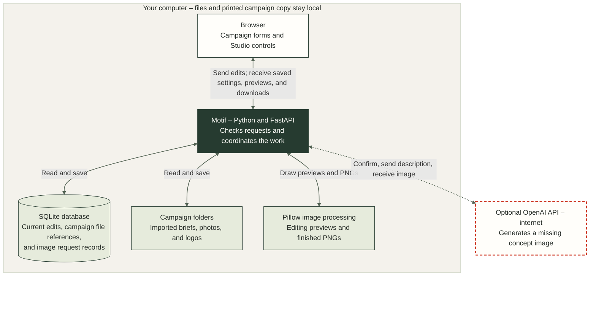

# How Motif works

This document describes Motif 0.3.2. Motif runs on the producer’s computer and opens in a browser. The browser displays the campaign and editing controls. A Python application on the same computer saves changes, reads photographs and logos, and creates image previews and downloads.

There are two different kinds of image creation. **OpenAI can create a missing product photograph after the producer confirms a paid request. Pillow combines an existing photograph with text and a logo to make the finished ads locally.** Editing a headline, moving a logo, and downloading a campaign do not ask OpenAI for another photograph.

The shaded boundary contains the local application. The dashed connection is the optional paid API request. Pillow creates temporary previews while editing and finished files on download; Motif checks and packages those files before returning them to the browser.

## Follow one edit from the browser to the download

Suppose the logo is too close to the edge of the lantern’s English Story image. The producer opens that image in Studio and drags the logo inward. JavaScript, the code running in the browser, moves it immediately. When the producer releases the mouse, the browser sends the new position to the local Python application.

Python checks the submitted values and saves the new position in SQLite. SQLite is the software that reads and updates Motif’s local database file. The saved information is an instruction about where to place the logo; the original logo artwork and lantern photograph remain separate files. Motif does not permanently paint the logo into the photograph during editing.

When the producer returns to that image, Motif reads the photograph, logo, and saved instructions and shows them together again. There is no need to separate elements from a finished image. The original elements were never discarded.

When the producer chooses **Download ZIP**, Pillow makes the finished PNGs. Each PNG combines the photograph, supplied words, and logo into a single image that can be used without Motif. The logo move affects the next download. It cannot change a PNG that the producer already downloaded or sent to someone else.

## What is saved, and where

One `Workspace` folder holds the saved work for this installation. It contains one database for all campaigns and a separate folder for each campaign’s files.

| Location | What it contains and why |
| --- | --- |
| `Workspace/private/state.sqlite3` | The local SQLite database. Motif reads it to reopen campaigns, display current settings, locate each campaign’s files, and check image-generation requests. |
| `Workspace/Campaigns/<name-and-id>/Brief/Imports/` | A copy of an imported brief, if one was supplied. This preserves the original input. Later edits are saved in SQLite rather than written back into this file. |
| `Assets/Products/` inside the campaign | Uploaded product photographs. |
| `Assets/Brand/` inside the campaign | Uploaded logos. |
| `Runs/<id>/` inside the campaign | Files used for source-image production, including saved request information and a returned image or response. A run is an operation that prepares product photographs; it is not a logo move or an ordinary autosave. |

Folders are created when needed. A campaign created from scratch has no imported brief to preserve, so Motif does not invent an `original.json` file for it. Current editing creates no permanent `Outputs/`, `Exports/`, or ZIP archive. It also creates no separate working `draft.json`, `plan.json`, or `manifest.json` files beside the images.

Uploaded files have readable names followed by unique identifiers, such as `leaflight-lantern-<identifier>.png`. The name helps a person recognize the file; the identifier distinguishes separate uploads with the same name. Moving text or changing the crop does not rename the photograph.

Each campaign also has a permanent ID. Two campaigns can share a display name without sharing files or settings. Renaming a campaign does not change its ID, folder, or browser address.

### How the database is organized

A database table is a collection of rows. Each row has named columns. Motif uses several tables because campaign identity, editable settings, and external image requests have different purposes.

| Table or column | What Motif uses it for |
| --- | --- |
| `campaigns` | The campaign’s permanent ID and the folder containing its files. |
| `campaign_drafts.document_json` | Current products, markets, wording, branding, crop and layout choices, image descriptions, file references, and a save-version marker. Campaign, Studio, Handoff, and downloads read this information. |
| `runs` | The operation that prepares product photographs, its status, and the requests the producer authorized. |
| `attempts` | Each request actually sent to OpenAI, whether it succeeded, its reported usage, and where returned files were saved. |
| `file_owners` and upload records | Which campaign a file belongs to. This prevents a request for one campaign from accessing or deleting another campaign’s file. It does not represent different people or user accounts. |
| Cleanup and upgrade records | Information needed to finish an interrupted campaign deletion or supported workspace upgrade safely. |

The `campaign_drafts` table has two columns: `campaign_id` and `document_json`. The second contains JSON text inside SQLite, not a filename. JSON organizes information as named values and lists. A headline field contains the headline’s words; a logo-position field contains its coordinates. Together, these values describe the current campaign.

An autosave replaces this current document. It does not add a new row for every adjustment. Records of actual OpenAI requests are separate because Motif must remember that a potentially paid request was sent even if its response was lost. Those records are not an image-edit history.

Tables such as `revisions` and `package_exports` support workspaces from earlier releases. The current editing and download workflow does not accumulate new revision or export records after every action.

## Autosave and two browser windows

Campaign text fields save after a short pause in typing. Studio saves after a typing pause or a completed gesture, such as releasing a dragged logo. Existing product fields also autosave. **Done** finishes pending saves and closes the product editor. A new product is added only after **Add product** validates the form. Canceling that unfinished form does not add a product or store its selected image.

Normal page navigation and export wait for pending saves. Routine saves are silent. A failed save displays an error and an appropriate retry or refresh action.

Motif gives the current saved document a version marker to prevent one window from overwriting newer work from another. This is a randomly generated 32-character value inside the JSON document, separate from the permanent campaign ID.

For example, two windows open the same campaign. Window B moves a logo and saves it. Window A then tries to save based on the older settings it loaded. The server compares Window A’s marker with the current marker, sees that they differ, and refuses the outdated save. Refresh loads the latest saved campaign and discards that window’s unsaved edits.

The check covers the whole campaign. Two windows editing different products can therefore still conflict. Neither a successful save nor a conflict changes the campaign’s folder name.

## How previews stay editable

Motif builds a preview from the current settings, original photograph, and logo. Pillow calculates text wrapping, font measurements, cropping, and placement. The browser also uses separate image and text layers to respond while a producer drags or resizes an element. After a first logo attachment in Studio, it loads those layers before enabling direct manipulation and keeps the existing preview visible while they load. If that preview fails, **Retry preview** reloads it without discarding the logo or its placement. Temporary previews show the composition without retaining a permanent finished PNG for every edit.

Preview and download use the same Pillow composition code and packaged fonts, Noto Sans Regular and Barlow Condensed Semibold. Selection boxes and editing handles are not included in downloaded images.

The shared headline and default color come from the campaign settings. Typing in Studio changes the selected product's wording across its three formats in the selected language. The **Apply to all products** button copies that field's wording to every product in the language and updates the matching Campaign field. Editing the Campaign headline or call to action also replaces that field's wording for all products, including earlier individual wording changes. Neither action changes the other text field or any visual styling. Shared color changes preserve deliberately customized colors. Position, size, font, color, crop, and logo placement can differ by product, language, and format.

Campaign text editing asks for confirmation before replacing custom wording. Until the producer confirms, the existing individual wording stays saved. Cancelling restores the previous Campaign field. The Studio button already states that it applies the wording to all products, so it performs that one-time action directly.

Campaign and Studio both save wording that contains a prohibited word. Their previews show that current wording, and the warning identifies what must be corrected before export. Removing one of several prohibited words updates the preview and leaves only the remaining warnings. These checks do not prevent Production from preparing source photographs.

Internally, `Workspace.current_composition()` turns the saved campaign into a temporary `Plan` object in memory. Five products, two markets, and three formats become 30 sets of image instructions. This is a calculation used for previewing and downloading, not another independently saved copy of the campaign.

## When Motif calls OpenAI

Production shows which product photographs are available and which still need to be supplied or generated. Selecting generation prepares the proposed request and estimated cost. It does not send the request by itself.

After confirmation, Motif records the request before contacting OpenAI. The request includes the product description, audience, scene direction, and generation settings. It remains fixed while OpenAI works. Later campaign edits cannot silently change a request already sent.

Motif saves the returned response before trying to decode its image. A usable photograph becomes available for Studio and later downloads. If local processing fails after the response was saved, Motif can try to use that saved response again without asking OpenAI to generate another image.

A lost connection does not tell Motif whether OpenAI completed or charged for a request. Motif therefore does not automatically repeat paid requests. **Stop** prevents requests that have not been sent; it cannot recall one already accepted by OpenAI. Product photographs are generated one request at a time.

A successful request does not create every final ad. The photograph stays separate from the wording and logo. Pillow combines them locally when the producer downloads.

## What happens during Download ZIP

Handoff shows previews based on the current saved settings. Download ZIP then performs these steps:

1. **Finish saving edits.** The browser waits for its pending autosaves. The server checks that the requested campaign version is still current.
2. **Keep consistent inputs for this download.** Motif takes the current instructions and temporary copies of the required photographs and logos. It checks that each file belongs to the campaign and has not changed while being copied. An edit in another window cannot alter only some images halfway through the download.
3. **Create and check each PNG.** Pillow combines each photograph, text, and any attached logo. Motif checks dimensions, the color profile, text placement, and the rendered artwork. Prohibited wording stops the download. A logo is optional; Handoff reminds the producer when none is attached, but the images can still be downloaded.
4. **Package the files.** The ZIP contains the PNGs, an `index.html` report, and a `manifest.json` listing the delivered files. Motif checks the archive before sending it to the browser.
5. **Release temporary files.** When the response finishes or closes, Motif removes its temporary working files. The browser saves the downloaded ZIP wherever the producer chooses.

A checksum is a value calculated from a file’s contents. Motif uses it to notice when a file has changed or been damaged. The downloaded manifest lists the PNGs with their products, markets, formats, dimensions, wording, and checksums. It describes the delivery; it is not the editable campaign document that Studio reads.

### If one or more images fail

Each PNG is created separately. If images 3, 10, and 12 fail, Motif continues with the others and then tries those failed images once more. The counter reports the number successfully created and checked, for example **Creating images: 14 of 30**.

If problems remain, **Retry failed images** works only on the failures. Successful PNGs stay temporarily available. A problem packaging the ZIP also keeps the completed PNGs available, so they do not need to be created again.

Motif keeps at most one temporary export job. Its files may use operating-system temporary storage outside the campaign folder. They are released after delivery, cancellation, application exit, or ten minutes without activity while waiting for a retry. Starting another export replaces an idle failed job. On Windows, temporary files may be visible in the system temporary directory until they close; they are not permanent campaign files.

If the campaign changed before a retry, Motif discards the old temporary work and asks for a refresh and a new download. It does not combine PNGs made from different settings.

An explicitly selected partial download can omit product photographs already known to be missing and list those omissions. It does not silently omit an image that failed during rendering. Downloading one PNG creates only that selected image. Neither kind of download calls OpenAI.

## The browser report and the downloaded report

**Preview offline report** opens a preview of the current campaign. Motif is still serving temporary preview images, so the application must remain running. If the campaign changes, the producer needs to reopen the report to see the latest work.

The report inside the ZIP uses the full-size PNGs included in that ZIP. After extraction, a recipient can open `index.html` without Motif, an API key, or an internet connection. The image links keep working when the extracted folder is moved as a whole.

## Why these technologies

**Python, FastAPI, and Jinja2.** Python provides image-processing and file-handling tools. FastAPI receives browser requests and calls the relevant Python functions. Jinja2 serves the page shell and startup settings. Plain JavaScript fetches the saved campaign and handles controls, dragging, and preview updates. Developers do not need a separate process to compile and bundle a React or TypeScript interface before running Motif.

That choice fits the local installation and initially simpler interface. The richer Studio editor requires careful handling of requests that finish at different times. A larger editor maintained by a team would give React and TypeScript more value through reusable interface components and checks on the values passed between them.

**SQLite with JSON editing instructions.** SQLite provides transactions: related database changes either finish together or leave the previous saved data intact. It also keeps the campaign-to-file relationships and request records in one place. JSON lets Motif load the small campaign’s editing settings together without creating a table for every kind of layout control.

The trade-off is that a small edit rewrites the campaign’s JSON text, and the conflict check covers the whole campaign. Separate records for individual images would become useful if several people needed to edit different products simultaneously. A JSON-file-only implementation could work locally, but would need its own coordination for simultaneous saves, interrupted writes, file relationships, and paid requests.

**Pillow for previews and final files.** The application controls exact wording, fonts, and placement instead of asking a model to draw advertising text. One photograph can support many formats. Saving instructions avoids repeatedly creating all the finished ads during editing. Rendering at download time adds a short wait at the end, making matching preview and download behavior especially important.

**A local application rather than a hosted service.** SQLite needs no separate database server, and photographs remain ordinary local files. A shared hosted version would add sign-in, permissions, a shared database such as PostgreSQL, cloud file storage, and workers for longer image jobs. SQLite helps this prototype save reliably; it does not automatically supply those hosted features.

## File safety, upgrades, and local security

The application checks which campaign a file belongs to before reading or deleting it. A path written in an imported brief is only text; the producer must attach the actual file. Imported text cannot authorize access to another campaign’s files.

Removing a product or logo disconnects it from the current campaign settings. Its uploaded file stays in the campaign's Assets folder so the producer can select it again. Replacing an attachment also keeps the previous file. SQLite retains the file's campaign association so campaign deletion can still find it.

Delete campaign removes registered files, including retained attachments, and related database records, then removes empty directories. Files added outside Motif are left alone. If deletion is interrupted, Motif uses its recorded file list to continue after restart. The supported v0.2.0 upgrade transfers current editing settings into the new document and removes recognized obsolete working files only after checking their replacements. Original imports, useful photographs, earlier exported packages, and unrecognized user files are preserved.

Back up the whole Workspace with Motif stopped. A campaign folder alone does not include its current database settings.

Motif listens only on the computer’s local address. Saving requests must come from an allowed origin and include the token supplied by the running application. Input checks reject invalid paths and unsafe file links. HTML escaping displays entered markup as text, and text-only browser updates prevent ordinary form content from becoming executable JavaScript.

The API key stays outside campaign folders and downloads. On macOS and Linux, the key dialog saves it in a user-owned `.env` file; on Windows, Windows encrypts it for the current user. An environment-supplied key takes precedence. Removing a key in Motif removes the locally saved credential, not the key in the OpenAI account.

Motif assumes a trusted local computer. It has no individual accounts or team permissions. Public hosting would require authentication, authorization, and operational design in addition to these local checks.
