# Architecture

This document describes **Motif 0.3.0**. Motif is one Python application with a browser interface. FastAPI handles application operations, Jinja2 supplies the page shell, and plain JavaScript manages the editor and its interactions. Pillow creates visual previews and the finished images requested for download. SQLite stores the current campaign and the records needed to manage source generation.

```mermaid
flowchart LR
  Import[Imported original brief and attached files] --> Campaign[Campaign forms]
  Campaign -->|Autosave fields| DB[(SQLite: one current campaign document)]
  Studio[Studio text, logo, and crop controls] -->|Autosave editing instructions| DB
  DB --> Preview[Temporary visual previews]
  Assets[Campaign source images and logos] --> Preview
  Preview --> Studio
  DB --> Plan[Production plan and cost estimate]
  Plan -->|Explicit confirmation for missing imagery| Provider[OpenAI image adapter]
  Provider --> Assets
  Provider --> Evidence[(SQLite: request status and usage)]
  DB -->|Capture one saved version| Export[Download request]
  Assets -->|Check ownership and source hashes| Export
  Export --> Render[Render and verify finished PNGs in temporary storage]
  Render -->|Complete ZIP image set| Package[Prepare ZIP and check its contents]
  Render -->|Failed ZIP images only| Retry[Keep successful images and retry failed images]
  Retry -->|Complete intended image set| Package
  Render -->|Selected individual PNG| Download[Browser download]
  Package --> Download
```

## What lives where

A campaign has a stable UUID and one permanent folder. Its display name can change without changing that identity. `campaigns(id, folder)` maps the UUID to its folder under `Workspace/Campaigns/`. The application records the files belonging to each campaign before writing them. Imported text, a display name, or a path in an imported brief cannot grant access to another campaign’s files.

**SQLite holds the current editable campaign.** The `campaign_drafts` table has one row per campaign. Its `document_json` column contains the current Campaign fields, product choices, copy, brand choices, individual image layout and style settings, accessible descriptions, source references, and a version token. An ordinary autosave replaces that current document. It does not add another row for every logo movement or retain every earlier version.

**The campaign folder holds the actual source files.** These include uploaded photographs and logos, an original imported brief when present, and sources and response material from confirmed image-generation requests. New uploaded photographs and logos use a lowercase, hyphenated product or brand label followed by a unique identifier in `Assets/Products/` or `Assets/Brand/`. The registered identity controls access; the label only helps people recognize the file. Existing registered asset names remain valid. The original import is an input record; editing the campaign does not rewrite that imported file. New work does not create permanent `Outputs/` or `Exports/` directories, working `draft.json`, `plan.json`, or `manifest.json` copies, or a ZIP archive beside the campaign.

A downloaded package is different: it contains finished PNGs, `index.html`, and a delivery `manifest.json`. That manifest describes the files in the download, including dimensions and checksums. It is not another working campaign document that the editor reads.

## Saving and reopening an edit

Campaign and Studio use the same current editing document. Changing a shared headline in Campaign therefore changes the saved wording that Studio reads. A deliberate product-specific wording override remains that product’s choice. Similarly, a shared brand color changes text that inherits the campaign default; a block with its own saved color keeps that color.

Campaign text fields save after a short typing pause. Studio saves after typing pauses or completed editing gestures, such as releasing a dragged logo. There is no ordinary Apply or Update Images step. Routine saves are silent. The browser finishes pending saves before normal navigation or export, and shows a clear error or Refresh action when a save cannot be accepted. Existing product fields also autosave; Done finishes pending saves and closes the product editor. A new product remains a separate unfinished form until Add product validates and adds it. Cancel discards that unadded product and its browser-held image. Image validation creates no stored asset; the file is adopted only when the product is successfully added.

A save includes the version the browser last read. The server compares it with the current version before accepting changes. For example, if two tabs both open the same campaign, and the first saves a logo change, the second cannot overwrite that newer campaign using an older version. The second tab pauses saving and displays the same Refresh notice used in Campaign and Studio. Refresh loads the latest saved work and discards that window’s unsaved edits; there is no review or merge overlay. A retry after a lost response can recognize the already accepted save.

A successful Studio save writes editing instructions to SQLite. It does not render a finished PNG, copy unrelated images, or create a new campaign directory. A preview may use temporary Pillow composition to show the proposed appearance. Reopening Studio reads the original photograph, the logo, and the saved instructions. Nothing needs to be separated from a flattened image: those inputs were never discarded.

## Previews and editing controls

`Workspace.current_composition()` reads the current saved document and resolves it into a `Plan` in memory. That view expands the selected products, markets, and formats into individual output instructions. It checks attached assets and determines which source images are ready. This temporary view is not a second stored editing document or a new production authorization.

Studio keeps one product canvas visible while Text, Framing, Logo, or Inspect controls occupy its side panel. Text and logo manipulation share pointer and keyboard mechanics. Pillow supplies measured text layouts, clean image layers, and temporary rendered previews. The packaged Noto Sans Regular and Barlow Condensed Semibold fonts are used by both preview and export, so the same layout logic controls the finished result.

Brand can recolor Pillow-supplied text layers immediately while its updated full preview is prepared. These layers preserve the renderer's exact letter shapes and line breaks; custom block colors remain separate from the default. Studio keeps the displayed composition visible during a tool switch for that same product, market, and format. A different format or product gets its own preview. Preview URLs and cache entries remain tied to the current saved version.

Text wording can apply to one product or all products in the selected market; its three formats use that wording. Position, size, font, and per-block color belong to the selected product, market, and format. Crop settings and logo position also belong to that selected image. The producer controls intentional overlap, placement, and creative readability. The application checks technical limits such as image decoding, supported fonts, valid coordinates, and protected crop bounds.

An invalid or incomplete field can be retained for correction where the editing contract allows it. Saving a field is not proof that its image is ready for export. The current preview, Production checks, and export admission use the current saved content and show the relevant problem.

## Source generation is a separate action

Supplied photographs and verified saved generated sources can be reused without a key. Missing imagery requires a Production plan and deliberate confirmation. Planning resolves the current campaign, verifies assets, constructs the proposed image requests, and shows their estimated cost. It does not make a paid request.

Confirmation binds the displayed plan’s digest, including relevant input hashes and request settings. If those inputs change before dispatch, the producer must review the changed plan. Once a request has been dispatched, it finishes against the inputs already authorized for that request. Later Campaign edits do not silently change the request in flight.

The runner records dispatch intent in SQLite before contacting the provider. Network work takes place outside that short transaction. The adapter preserves the returned response before decoding it. Successful production saves the source image and records its readiness; it does not compose all the final formats. Stop prevents unsent requests but cannot promise to cancel a request the provider has already accepted. A timeout remains an uncertain outcome, and no paid retry happens automatically.

Unfinished production retains the exact authorized inputs needed for recovery. Completed production retains request evidence, source identity, usage, and the information needed to determine whether that source can be reused. It does not become an alternative authority for the campaign’s current text, crop, or logo settings. Editing a headline, changing a default color, and downloading a package create no provider attempt records.

## Downloading a finished campaign

Handoff shows previews of the current saved composition. Download ZIP performs the final rendering and packaging in one action:

1. The browser finishes pending autosaves and requests the version it just saved. If another tab has already changed it, the server refuses that outdated request.
2. The server captures the current instructions, descriptions, source references, and campaign request metrics. It copies the required source bytes into private temporary storage, checking campaign ownership and each expected checksum. Missing or unreadable sources, and files changed between planning and capture, stop the download.
3. Pillow renders the selected full-size PNGs from those captured inputs. Checks inspect the actual PNG dimensions, color profile, visible logo pixels, and visible text colors. Prohibited wording and a required missing logo block delivery. A partial package requires explicit selection of sources known to be missing before rendering. It identifies those omitted images; it does not bypass an image or text validation failure.
4. Motif prepares the ZIP with readable product, market, and format paths, the offline report, and the delivery manifest. It checks the ZIP before returning it to the browser.
5. The ZIP response uses memory for small packages or an operating-system temporary file for larger packages. Closing the response, including a failed or interrupted transfer, closes the ZIP, the temporary source copies, and the rendered PNGs. Motif retains no campaign ZIP archive.

The interface counts only verified PNGs: **Creating images: 14 of 30.** If an image fails, Motif identifies its product, format, and market, continues creating the other images, and then tries each failed image once more. The display explicitly identifies the image being retried. If that bounded local retry still fails, **Retry failed images** resumes only the failed items. Already checked images are not rendered again. Once the intended set is complete, the stages become **Preparing ZIP** and **Checking download**. A ZIP-preparation failure also preserves the checked PNGs for retry; it does not send an incomplete download.

The application keeps at most one temporary export job. Its source copies and checked PNGs use unnamed operating-system temporary files, outside campaign folders. The job is closed after delivery, explicit cancellation, or ten minutes without activity while waiting for retry; process exit also closes its files. Job status is process memory, not SQLite or a retained export history. Starting a different export discards an idle failed job.

The producer can keep editing after the export has captured its inputs. Those later edits belong to the next saved version; they cannot change half the files in an export already being rendered. A failure does not overwrite the saved campaign. Retrying a failed job checks that its saved version is still current. If the campaign changed, Motif discards the old temporary job and asks the producer to start a new download, so the package cannot mix settings from different saves.

Downloading an individual PNG follows the same source and content checks but renders only that selected image. Export never calls the image-generation provider. Its work is local composition of already available sources.

Supplied photographs are read and hashed from their current files when the composition is prepared. Replacing an uploaded photograph outside Motif with another readable image before that preparation therefore uses the replacement; it is not compared with a permanent hash of the original upload. Saved generated masters have a recorded hash that must still match. Once export captures its sources, later file changes cannot alter the package being rendered.

## Report preview and offline report

Preview offline report opens a browser preview tied to one saved campaign version. The images in that preview are temporary, smaller visual previews. Motif must stay running to serve them. Opening the preview creates no permanent report directory, final-image set, or export record. If the campaign changes, the report asks the producer to reopen it rather than mixing different saved versions.

The report inside Download ZIP is the offline version. Its image links point to the full-size PNGs included in that same ZIP, and its manifest identifies those exact files and checksums. After extraction, the recipient can open `index.html` without Motif, an API key, or the original machine’s folder paths. Accessible descriptions and provenance travel with that captured campaign. Existing ZIPs and reports created by older Motif releases retain their original contents.

## Database responsibilities

| Record | Stored information and use |
| --- | --- |
| `campaigns` | Campaign identity and its permanent folder mapping. |
| `campaign_drafts.document_json` | The single current editing document: Campaign fields, image layout and style choices, source references, descriptions, a version token, and acknowledgement data. Campaign, Studio, Handoff, and export read this document. |
| `runs` | Production status, allowance, and authorized source-generation inputs while unfinished. Completed runs retain the source/request facts needed for accounting and reuse. |
| `attempts` | Each actual provider dispatch, its outcome, reported usage, and references to saved source/response files. Autosaves and downloads create no attempts. |
| File ownership and recovery records | Which campaign can access a managed file, pending uploads, and the exact files involved in an interrupted migration or confirmed deletion. |
| Legacy `revisions`, `creative_metadata`, and `package_exports` | Compatibility records for earlier saved images and deliveries. Current editing settings and descriptions belong to the current campaign document; new autosaves and downloads do not build a revision or export history. |

A table contains rows, and a row contains named columns. `campaign_drafts` has two columns: the permanent `campaign_id` and `document_json`. The latter contains JSON stored inside SQLite; it is not a filename. Its `version` field is a randomly generated 32-character marker for the current saved state. A save submits the marker the browser loaded; the server refuses the save if another save has replaced that marker. The permanent campaign ID and folder name stay unchanged, and replacing the marker does not preserve a historical campaign copy.

## Decisions and trade-offs

**One local application.** Python directly handles validation and imaging, and the interface needs no frontend build step. This keeps installation and the execution path manageable for a local producer. A hosted team product would require separate access, concurrency, storage, and operations decisions.

**Generate source photography, then compose locally.** One source can support several formats and markets. Text, color, and logo corrections do not require another image-generation request. The source still needs enough surrounding scenery for the intended crops; enlargement cannot recover detail that was never present.

**Save instructions while editing, render finished files at delivery.** A campaign-wide change saves without repeatedly rendering the whole campaign. Export does more work at the end, and accurate previews matter. Motif uses the same compositor for previews and final PNGs, verifies the finished files, and shows the actual download stages.

**SQLite plus source files.** SQLite provides transactions and relationship constraints. Motif uses it to store current campaign documents and paid request records, and implements its expected-version check while holding the short save lock. Image bytes remain ordinary files. A JSON-only application could provide a similar workflow, but would need its own safe replacement, coordination, and relationship checks. SQLite does not make filesystem writes or a remote provider request part of one database transaction; those operations still need explicit recovery behavior.

Keeping the campaign's editable settings together as JSON makes them straightforward to load and save as a complete document. It does not put campaign identity, file registration, or provider attempts into that same document; those have separate database records. The trade-off is that a metadata edit replaces the campaign's JSON text, and the version check covers the whole campaign. For a shared service where several producers edit different images concurrently, separate records for each image's settings would allow more independent saves.

**One production runner, short save locks.** The runner lock prevents overlapping production operations without adding a job framework. The separate campaign-save lock protects short metadata updates. Provider calls and final rendering do not hold that save lock. This allows editing to continue while a confirmed request or captured export is working.

**One provider adapter.** The official SDK handles the provider’s transport contract. A small adapter isolates that contract from the rest of Motif. Adding a different provider would require mapping its parameters, returned data, errors, and accounting and testing that integration; it is not an existing model-switching feature.

## Installation, upgrades, and cleanup

The default `Workspace` lives inside the extracted Motif installation beside `.venv`. An explicit command-line or environment setting can select another local directory. One SQLite database serves that workspace’s campaigns. The launcher uses one process bound to loopback; it does not open a public server.

First setup imports the seasonal examples as ordinary campaigns with owned attachments and fresh UUIDs. Autumn has sources for 30 image variations and can be previewed and exported without a key. Winter has one missing concept whose generation remains unconfirmed. Setup does not compose a permanent set of final PNGs. The packaged prepared-output descriptor is checked as example evidence, but those finished resource images are not installed as campaign outputs. Setup records support resuming an interrupted import without overwriting later edits or recreating a deleted example.

The upgrade path brings supported v0.2.0 settings into the current campaign document while preserving original inputs, useful source imagery, and earlier deliveries. It removes only recognized application-owned superseded data after its replacement is verified. Unknown user files are left in place. Older 0.1.x workspaces still require their original application.

Campaign deletion records the selected campaign’s exact managed files and hashes, checks ownership again before removal, and deletes its dependent database records. It removes directories only when empty. Downloaded copies are outside that campaign’s managed files. Startup resumes a previously confirmed interrupted deletion from its recorded file list.

Storage checks do not follow symbolic links or aliases. POSIX uses advisory file locks and same-volume publication with directory sync; Windows uses native byte-range locks and write-through moves and refuses junctions and other reparse points. Production checks space before a paid request. A failed metadata save leaves the previous saved document available, and a failed export leaves the current campaign unchanged.

## Local security boundaries

The browser’s state is not trusted to authorize file access. The server checks campaign ownership, the expected version, input size and shape, and allowed operations. Mutations require an origin check and a per-process token. Imported file paths are descriptive text until the producer attaches the actual file. The server rejects path traversal and unsafe aliases. Template escaping and text-only DOM updates prevent ordinary text fields from becoming executable HTML or JavaScript.

Credentials remain outside campaigns and exports. An explicit environment key takes precedence. The key dialog saves a user-owned `.env` on POSIX or current-user DPAPI ciphertext under `Workspace/private` on Windows. The process activates a saved key only after successful storage. Remove API key deletes a locally stored credential while preserving unrelated settings; it does not revoke the provider account’s key. An environment-managed key is changed outside Motif. Motif assumes a trusted local computer and does not provide accounts, team authorization, or a public-hosting security boundary.
